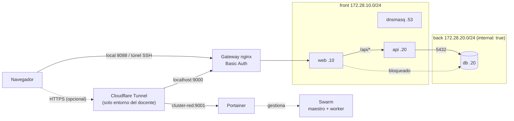

# Docker Swarm con Portainer — Laboratorio 14 (UTP)

Clúster **Docker Swarm** de dos nodos con **Portainer**, una aplicación de tres
capas (`web → api → db`) y una **red segmentada** donde la base de datos queda
aislada. Incluye un gateway nginx con Basic Auth para el acceso local.

> 📘 **Guía única de réplica:** [`docs/guia-cluster.md`](docs/guia-cluster.md).
> Está dividida en tres partes y contiene todos los comandos, las comprobaciones
> y la solución de problemas. Empieza por ahí.

## Estructura del proyecto

```text
docker-cluster-redes/
├── README.md
├── docs/
│   ├── guia-cluster.md                  # Guía única en 3 partes
│   └── capturas/                        # Capturas que se ven dentro de la guía
├── infra/
│   └── gateway/                         # Gateway nginx con Basic Auth
│       ├── docker-compose.yml
│       ├── nginx.conf
│       ├── README.md
│       └── .gitignore                   # Excluye .htpasswd y gateway.pass
├── api/
│   ├── app.py                           # API Flask: /health, /ping, /db, /info
│   └── requirements.txt
├── web/                                 # Panel visual del laboratorio
│   ├── index.html
│   ├── styles.css
│   ├── app.js
│   └── nginx.conf                       # Proxy /api → api:5000
├── examples/
│   └── index.html                       # Página mínima de la red plana
├── docker-compose-portainer.yml         # Portainer (9001 → 9000)
├── docker-compose-network.yml           # Stack segmentado front/back + DNS
├── docker-compose-network-planos.yml    # Red plana: el problema
├── Dockerfile.api                       # Imagen de la API
└── dnsmasq.conf                         # Zonas DNS internas .local
```

## Requisitos

- Dos máquinas Linux (Ubuntu 22.04/24.04 o Debian) en la misma red local.
- Docker Engine y el plugin `docker compose` instalados en ambas.
- 2 GB de RAM y 10 GB de disco por máquina.
- Acceso `sudo` para instalar Docker y abrir puertos del firewall.
- **No necesitas** dominio ni Cloudflare.

## Inicio rápido

Los comandos completos están en la [guía](docs/guia-cluster.md). Este es el
resumen:

### 1. Maestro y Portainer

```bash
git clone https://github.com/isaca0315/docker-cluster-redes.git ~/docker-cluster-redes
cd ~/docker-cluster-redes

# En el maestro
docker swarm init --advertise-addr <IP_MAESTRO>
docker stack deploy -c docker-compose-portainer.yml portainer
docker node ls
```

Portainer queda en `http://<IP_MAESTRO>:9001`.

### 2. Worker

En el maestro, obtén el comando de unión:

```bash
docker swarm join-token worker
```

Copia ese comando y ejecútalo en el worker:

```bash
docker swarm join --token <TOKEN> <IP_MAESTRO>:2377
```

Comprueba desde el maestro:

```bash
docker node ls
```

Deben aparecer dos nodos `Ready` y el maestro como `Leader`.

### 3. Segmentación y app

Vuelve al maestro, dentro del repositorio:

```bash
# Red plana: web SÍ alcanza la base de datos
docker compose -f docker-compose-network-planos.yml up -d
docker exec web-planos sh -c "nc -z -w 3 db 5432 && echo 'web alcanza db (inseguro)'"

# Red segmentada: web NO alcanza la base de datos
docker compose -f docker-compose-network.yml up -d
docker compose -f docker-compose-network.yml ps
```

La app queda en `http://127.0.0.1:8080`. La verificación completa son 7 pruebas;
están en la [sección 3.3 de la guía](docs/guia-cluster.md#33-verifica-la-segmentación-7-pruebas).
Las tres principales:

```bash
docker exec web getent hosts db                                      # sin salida
docker exec web sh -c "nc -z -w 3 172.28.20.20 5432; echo exit=\$?"  # exit=1
docker exec api python -c "import socket as s; s.create_connection(('172.28.20.20', 5432), 3); print('API -> DB OK')"
curl -s -o /dev/null -w '%{http_code}\n' http://127.0.0.1:8080       # 200
```

El gateway con Basic Auth se configura en la
[sección 3.4](docs/guia-cluster.md#34-gateway-con-basic-auth). Deja la app en
`http://127.0.0.1:8088/` y Portainer en `http://127.0.0.1:9090/portainer/`.

## Topología



La cadena obligatoria en local es navegador → gateway → `web` → `api` → `db`.
El túnel de Cloudflare es opcional y solo se usa si publicas la app en Internet.

## Servicios y redes

| Servicio | Redes | IP | Rol |
|---|---|---|---|
| `dnsmasq` | `front` | `172.28.10.53` | DNS interno de `.local` |
| `web` | `front` | `172.28.10.10` | nginx; publica `8080` solo en loopback |
| `api` | `front` + `back` | `172.28.10.20` y `172.28.20.30` | único puente hacia la DB |
| `db` | `back` | `172.28.20.20` | PostgreSQL; sin puertos publicados |

`back` usa `internal: true`: no tiene salida al exterior ni ruta desde `front`.
La única forma de llegar a la base de datos es a través de `api`.

## Panel visual

`web/` es una app sin dependencias externas que muestra el laboratorio con un
diagrama SVG animado, las redes, el DNS y el estado en vivo de la API. Consume
`/api/health`, `/api/db` y `/api/info` a través del proxy de nginx.

Las capturas reales se ven directamente en la
[guía](docs/guia-cluster.md#32-levanta-la-red-segmentada).

## Puertos

| Puerto | Interfaz | Uso |
|---|---|---|
| `2377` | LAN (TCP) | Gestión de Docker Swarm |
| `4789` | LAN (UDP) | Red overlay |
| `7946` | LAN (TCP/UDP) | Gossip entre nodos |
| `9001` | LAN | Portainer (`9001 → 9000`) |
| `9000` | `127.0.0.1` | Gateway nginx |
| `8088` | `127.0.0.1` | App a través del gateway |
| `9090` | `127.0.0.1` | Portainer a través del gateway |
| `8080` | `127.0.0.1` | App directa, sin auth |
| `8081` | `127.0.0.1` | Web de la red plana (demo) |

No expongas `2377`, `7946`, `4789` ni el socket de Docker a Internet.

## Notas de seguridad

- `internal: true` en la red `back` es lo que bloquea el acceso de `web` a `db`.
  Si la base de datos publica `ports:` o falta esa opción, el aislamiento se
  pierde.
- La app directa (`8080`) y el gateway (`9000`, `8088`, `9090`) escuchan solo en
  loopback. Portainer escucha en `9001` para la red local.
- El gateway se configura con un `.htpasswd` local que está en `.gitignore`.
  Nunca subas ese archivo ni la contraseña al repositorio.
- En `dnsmasq.conf` no uses `interface=0.0.0.0`: `interface` espera un nombre de
  interfaz, no una IP.
- El túnel de Cloudflare es opcional. Si no lo usas, ignora esa sección.

## Entregable

- [ ] Dos nodos `Ready` y el maestro como `Leader`.
- [ ] Portainer en `1/1`.
- [ ] `web`, `api` y `db` en `healthy`.
- [ ] Las 7 pruebas de segmentación coinciden con la guía.
- [ ] `web` no resuelve ni alcanza `db`; `api` sí la alcanza.
- [ ] DNS interno: `web.local`, `api.local`, `db.local`.
- [ ] Gateway: `401` sin credenciales y `200` con credenciales.
- [ ] Captura del stack y las redes dentro de Portainer.
- [ ] `git status` sin `.htpasswd` ni contraseñas.

## Limpieza

**Cuidado:** `down -v` borra los datos de la base de datos y de Portainer.

```bash
cd ~/docker-cluster-redes

# Stack segmentado y red plana (sin -v conserva los datos)
docker compose -f docker-compose-network.yml down
docker compose -f docker-compose-network-planos.yml down

# Gateway
cd infra/gateway
docker compose down
cd ~/docker-cluster-redes

# Portainer
docker stack rm portainer

# Salir del Swarm (primero el worker, después el maestro)
# docker swarm leave --force
```
