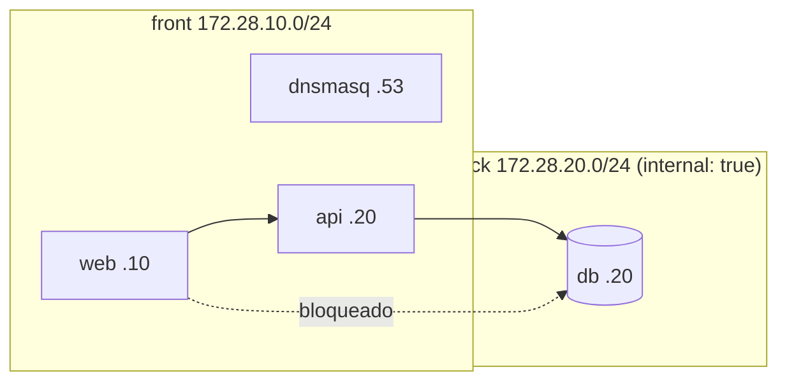

# Docker Swarm con Portainer

Guías completas para crear y gestionar un clúster **Docker Swarm** con
**Portainer**, incluyendo el laboratorio de **segmentación de redes**
(Laboratorio N.º 14 — Redes de Computadoras, UTP).

## 📁 Estructura del proyecto

```
docker-cluster/
├── README.md                                       # Este archivo
│
├── 📘 Documentación
│   ├── docker-swarm-portainer-parte1-maestro.md   # Parte 1: nodo maestro + Portainer
│   ├── docker-swarm-portainer-parte2-worker.md    # Parte 2: nodos worker
│   └── docker-swarm-portainer-parte3-segmentacion.md  # Parte 3: segmentación front/back (UTP L14)
│
├── 🐳 Stacks (docker-compose)
│   ├── docker-compose-portainer.yml               # Portainer CE            (project: portainer)
│   ├── docker-compose-agent.yml                   # Agente Portainer        (project: portainer-agent)
│   ├── docker-compose-examples.yml                # nginx 3 réplicas + hello (project: swarm-examples)
│   ├── docker-compose-redis-stack.yml             # Redis + exporter        (project: redis-stack)
│   ├── docker-compose-network.yml                 # Segmentado front/back + DNS (project: lab14-segmentado)
│   └── docker-compose-network-planos.yml          # Red plana: el problema  (project: lab14-plano)
│
├── 🔧 Dockerfiles
│   ├── Dockerfile.api                             # API Flask (UTP L14)
│   ├── Dockerfile.nginx                           # nginx con config propia
│   └── Dockerfile.hello                           # contenedor de prueba (referencia)
│
├── 🐍 api/
│   ├── app.py                                     # Flask: /health, /ping, /db
│   └── requirements.txt                           # flask, requests
│
├── ⚙️  dnsmasq.conf                                # Zonas DNS internas (.local)
│
├── 🛠️  scripts/  (todos ejecutables)
│   ├── init-swarm.sh                              # Inicializa swarm + Portainer
│   ├── join-worker.sh                             # Une un worker al swarm
│   ├── deploy-stack.sh                            # Despliega un stack
│   ├── validate-swarm.sh                          # Valida el clúster
│   ├── verificar.sh                               # Verifica segmentación y DNS (7 pruebas)
│   └── demo-scaling.sh                            # Demuestra escalado horizontal
│
├── 🌐 web/                                        # App visual del laboratorio
│   ├── index.html                                 # Panel + diagrama SVG animado
│   ├── styles.css                                 # Tema, tarjetas y animaciones
│   ├── app.js                                     # Datos, pestañas y polling en vivo
│   └── nginx.conf                                 # Sirve el front y proxy /api → api:5000
│
└── 📄 examples/
    ├── nginx.conf                                 # Config nginx de ejemplo
    └── index.html                                 # Página de ejemplo
```

## 🚀 Quick Start

```bash
cd docker-cluster
chmod +x scripts/*.sh
```

### A) Crear el clúster (Partes 1 y 2)

```bash
# En el MAESTRO: inicializa swarm + despliega Portainer
./scripts/init-swarm.sh

# En cada WORKER: únete al clúster
./scripts/join-worker.sh <IP_MAESTRO> <TOKEN>

# Validar el clúster (desde el maestro)
./scripts/validate-swarm.sh
```

Portainer queda disponible en `http://<IP_MAESTRO>:9000`.

### B) Laboratorio de segmentación (Parte 3 — UTP L14)

```bash
# Paso 1: la red plana (el problema) — web SÍ alcanza la db directo
docker compose -f docker-compose-network-planos.yml up -d
docker exec web-planos sh -c "nc -z -w 3 db 5432 && echo 'web -> db alcanzable (el problema)'"

# Paso 2: levantar la segmentada (coexiste con la plana, proyectos distintos)
docker compose -f docker-compose-network.yml up -d

# Paso 3: verificación automática -> 7 OK, 0 FALLO
./scripts/verificar.sh
```

**Salida verificada de `./scripts/verificar.sh`:**

```
1) web no resuelve db por nombre... ✅ OK
2) web no alcanza db por IP...      ✅ OK
3) api alcanza db por IP...         ✅ OK
4) nslookup web.local...            ✅ OK
5) nslookup api.local...            ✅ OK
6) nslookup db.local...             ✅ OK
7) web responde HTTP 200...         ✅ OK

Resultado: 7 OK, 0 FALLO
```

Y la API confirma el puente `front → back`:

```bash
docker exec api python -c "import requests; print(requests.get('http://localhost:5000/db').text)"
# -> {"db":"reachable","host":"db","port":5432}
```

### Panel visual del laboratorio

`web/` contiene una app completa (HTML/CSS/JS, sin dependencias externas) que
se sirve en `http://localhost:8080` y, por el túnel, en
`https://app-red.ponciop.online/` con Basic Auth.

- **Diagrama SVG animado:** Cloudflare → gateway nginx → `web` → `api` → `db`,
  con paquetes en movimiento, red `front` y red `back` (internal), DNS y Swarm.
- **Infraestructura:** nodos `kernel-lab` (Leader) y `ubuntu24-cwl` (Worker),
  Portainer, gateway, tunnel, web, api, db y dnsmasq.
- **Redes:** subredes, IPs estáticas, miembros, tabla DNS y las 7 pruebas de
  segmentación.
- **Desarrollo:** stack, endpoints con estado en vivo, recorrido de una petición
  y el JSON real de `/api/db` + `/api/info`.
- Haz clic en cualquier nodo del diagrama para saltar a su ficha técnica.

Endpoints que consume el panel (todos vía `web` → `api`):

| Endpoint | Devuelve |
|---|---|
| `GET /api/health` | `{"status":"healthy","service":"api"}` |
| `GET /api/db` | `{"db":"reachable","host":"db","port":5432}` |
| `GET /api/info` | hostname, Python, uptime, IPs y target de DB |

### C) Escalado en el clúster (extra Swarm)

```bash
docker stack deploy -c docker-compose-examples.yml my-nginx
./scripts/demo-scaling.sh my-nginx 5
```

## 🏗️ Topología del laboratorio (UTP L14)



**Restricciones de seguridad verificadas:**

| Prueba | Resultado esperado |
|--------|--------------------|
| `web` → `db` por nombre | no resuelve |
| `web` → `172.28.20.20:5432` | timeout (sin ruta) |
| `api` → `172.28.20.20:5432` | conecta |
| `nslookup web.local` @172.28.10.53 | `172.28.10.10` |
| `nslookup api.local` @172.28.10.53 | `172.28.10.20` |
| `nslookup db.local` @172.28.10.53 | `172.28.20.20` |
| `curl localhost:8080` | `HTTP 200` |

## 📚 Documentación por partes

| Parte | Archivo | Contenido |
|-------|---------|-----------|
| 1 | `docker-swarm-portainer-parte1-maestro.md` | `swarm init`, Portainer, firewall, primer stack |
| 2 | `docker-swarm-portainer-parte2-worker.md` | `swarm join`, verificación, diagnóstico, labels |
| 3 | `docker-swarm-portainer-parte3-segmentacion.md` | redes `front`/`back`, `internal: true`, DNS interno |

## 🔧 Comandos útiles

```bash
# Clúster
docker node ls                                  # nodos
docker node inspect --pretty <NODE_ID>          # detalle de un nodo
docker node update --label-add role=web <ID>    # etiquetar nodo

# Servicios y stacks
docker stack ls
docker stack services <stack>
docker service ls
docker service ps <stack>_<service>
docker service logs -f <stack>_<service>
docker service scale <stack>_<service>=5
```

## 📖 Puertos

| Puerto | Uso |
|--------|-----|
| 2377 | Swarm management (TCP) |
| 4789 | Overlay network (UDP) |
| 7946 | Gossip protocol (TCP/UDP) |
| 9000 | Portainer UI |
| 8000 | Portainer Edge |
| 8080 | Web (stack segmentado) |
| 8081 | Web (red plana) |
| 5000 | API Flask (interno) |
| 53 | DNS interno (dnsmasq) |

## ⚠️ Notas importantes

- **Cada stack tiene su propio `name:` de proyecto**, así los dos stacks del
  laboratorio (plano y segmentado) pueden estar levantados **a la vez** sin
  destruirse entre ellos. Sin esto, ambos usan el nombre del directorio
  (`docker-cluster`) y los servicios `web`/`db` colisionan.
- **`docker compose` vs `docker stack deploy`:** el stack segmentado
  (`docker-compose-network.yml`) usa IPs estáticas (`ipv4_address`) y `dnsmasq`
  para replicar el laboratorio del L14 — eso funciona con `docker compose`.
  En Swarm, `docker stack deploy` **no admite IPs estáticas** en redes overlay
  ni construye imágenes (`build:`); allí se usa el DNS interno de servicios de
  Swarm (`<servicio>`) en lugar de `*.local`. Por eso
  `docker-compose-examples.yml` usa imágenes publicadas y sin `container_name`.
- **`internal: true`** en la red `back` es lo que bloquea el acceso de `web` a
  `db`. Si la DB publica `ports:` o falta esa opción, el aislamiento se pierde.
- **Acceso remoto seguro:** `web` (8080) y `web-planos` (8081) se publican solo
  en `127.0.0.1`. El túnel de Cloudflare entra por el gateway nginx con Basic
  Auth (`~/lab14-gateway`):
  - `https://app-red.ponciop.online/` → app completa (gateway 9000 → web 8080).
  - `https://app-red.ponciop.online/api/db` → web reenvía a `api:5000`, que
    consulta `db:5432`.
  - `https://cluster-red.ponciop.online/` → Portainer directo (login propio).
  El gateway también ofrece acceso local en `8088` (app) y `9090` (Portainer).
  No expongas los puertos 2377/7946/4789 ni el socket de Docker.
- **Proxy front → API:** `web/nginx.conf` monta en `web` un `location /api/`
  que reenvía a `http://api:5000/`. Sin ese proxy el navegador no puede hablar
  con la API (la API no publica puertos al host).
- **Panel visual (`web/`):** SPA sin frameworks que muestra el laboratorio con
  un diagrama SVG animado (paquetes, flujos y pulsos), pestañas de
  **Infraestructura**, **Redes** y **Desarrollo**, y estado en vivo cada 4 s
  contra `/api/health`, `/api/db` y `/api/info`. Se sirve desde
  `web/nginx:alpine`; `examples/index.html` queda como página mínima de ejemplo.
- Las IPs de `dnsmasq.conf` deben coincidir con las de `docker-compose-network.yml`.
- En `dnsmasq.conf` **no uses `interface=0.0.0.0`**: `interface` espera un
  *nombre* de interfaz (ej. `eth0`), no una IP. Con un valor inválido dnsmasq
  termina respondiendo solo en loopback y las consultas de otros contenedores
  expiran (síntoma: `;; connection timed out; no servers could be reached`).

## 🧪 Entregable (UTP L14)

- [ ] Stack con redes `front`/`back` (`back` con `internal: true`).
- [ ] `web` NO resuelve ni alcanza `db` (por nombre y por IP).
- [ ] `api` SÍ alcanza `db`.
- [ ] DNS interno: `web.local`, `api.local`, `db.local`.
- [ ] `web` responde `HTTP 200` en `localhost:8080`.
- [ ] Salida de `./scripts/verificar.sh` = **7 OK, 0 FALLO**.
- [ ] Captura del stack y las redes en Portainer.

## 🧹 Limpieza

```bash
docker compose -f docker-compose-network.yml down -v --remove-orphans
docker compose -f docker-compose-network-planos.yml down -v --remove-orphans
docker stack rm my-nginx
docker stack rm portainer
```
