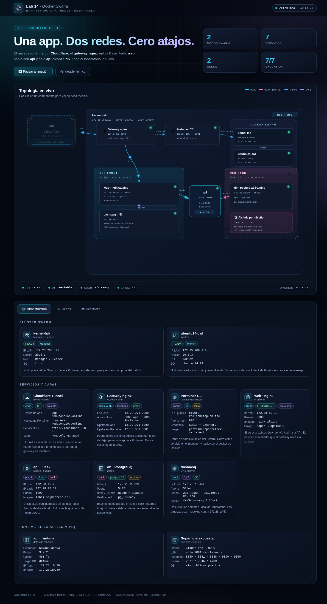
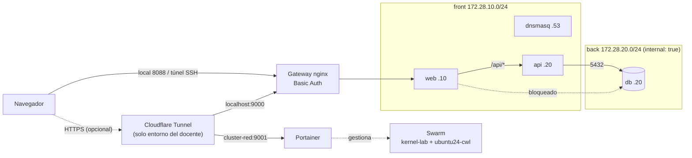

# Docker Swarm con Portainer

Guías completas para crear y gestionar un clúster **Docker Swarm** con
**Portainer**, incluyendo el laboratorio de **segmentación de redes**
(Laboratorio N.º 14 — Redes de Computadoras, UTP).

> 📚 Documentación completa con capturas y transcripciones reales: [`docs/`](docs/README.md).
>
> 🧭 ¿Vas a replicar el laboratorio? Sigue la
> [guía paso a paso](docs/00-guia-replica.md).

## 📁 Estructura del proyecto

```
docker-cluster-redes/
├── README.md                                       # Este archivo
│
├── 📘 Documentación
│   ├── docs/                                      # Documentación completa + evidencia
│   │   ├── README.md                              # Índice general
│   │   ├── 00-guia-replica.md                     # Réplica paso a paso (empieza aquí)
│   │   ├── 01-arquitectura.md … 08-pendientes.md  # Guías del laboratorio
│   │   ├── capturas/                              # 17 capturas reales (app, Portainer, terminales)
│   │   └── salidas/                               # 9 transcripciones de comandos
│
├── 🔐 infra/
│   └── gateway/                                   # Gateway nginx versionado (Basic Auth)
│       ├── docker-compose.yml                     # nginx:alpine con network_mode: host
│       ├── nginx.conf                             # 9000 / 8088 / 9090 + Basic Auth
│       ├── README.md                              # Preparación, puertos y túnel
│       └── .gitignore                             # Excluye .htpasswd y gateway.pass
│
├── 🐳 Stacks (docker-compose)
│   ├── docker-compose-portainer.yml               # Portainer CE            (project: portainer)
│   ├── docker-compose-agent.yml                   # Agente Portainer        (project: portainer-agent)
│   ├── docker-compose-examples.yml                # nginx 3 réplicas + hello (project: swarm-examples)
│   ├── docker-compose-redis-stack.yml             # Redis + exporter        (project: redis-stack)
│   ├── docker-compose-network.yml                 # Segmentado front/back + DNS (project: lab14-segmentado)
│   └── docker-compose-network-planos.yml          # Red plana: el problema  (project: lab14-plano)
│
├── 🔧 Dockerfiles
│   ├── Dockerfile.api                             # API Flask (UTP L14)
│   ├── Dockerfile.nginx                           # nginx con config propia
│   └── Dockerfile.hello                           # contenedor de prueba (referencia)
│
├── 🐍 api/
│   ├── app.py                                     # Flask: /health, /ping, /db
│   └── requirements.txt                           # flask, requests
│
├── ⚙️  dnsmasq.conf                                # Zonas DNS internas (.local)
│
├── 🛠️  scripts/  (todos ejecutables)
│   ├── init-swarm.sh                              # Inicializa swarm + Portainer
│   ├── join-worker.sh                             # Une un worker al swarm
│   ├── deploy-stack.sh                            # Despliega un stack
│   ├── validate-swarm.sh                          # Valida el clúster
│   ├── verificar.sh                               # Verifica segmentación y DNS (7 pruebas)
│   ├── demo-scaling.sh                            # Demuestra escalado horizontal
│   ├── capturar-docs.sh                           # Regenera transcripciones y capturas
│   └── docs/                                      # Render de terminales y CDP (Chrome)
│
├── 🌐 web/                                        # App visual del laboratorio
│   ├── index.html                                 # Panel + diagrama SVG animado
│   ├── styles.css                                 # Tema, tarjetas y animaciones
│   ├── app.js                                     # Datos, pestañas y polling en vivo
│   └── nginx.conf                                 # Sirve el front y proxy /api → api:5000
│
└── 📄 examples/
    ├── nginx.conf                                 # Config nginx de ejemplo
    └── index.html                                 # Página de ejemplo
```

## 🚀 Inicio rápido

```bash
cd docker-cluster-redes
chmod +x scripts/*.sh
```

> Si es tu primera vez, la [guía de réplica](docs/00-guia-replica.md) tiene el
> orden completo, las comprobaciones y la solución de problemas.

### A) Crear el clúster

```bash
# En el MAESTRO: inicializa swarm + despliega Portainer
./scripts/init-swarm.sh

# En cada WORKER: únete al clúster
./scripts/join-worker.sh <IP_MAESTRO> <TOKEN>

# Validar el clúster (desde el maestro)
./scripts/validate-swarm.sh
```

Portainer queda disponible en `http://<IP_MAESTRO>:9001` (en este laboratorio,
`9001 → 9000`; el `9000` del host lo usa el gateway con Basic Auth).

### B) Laboratorio de segmentación (UTP L14)

```bash
# Paso 1: la red plana (el problema) — web SÍ alcanza la db directo
docker compose -f docker-compose-network-planos.yml up -d
docker exec web-planos sh -c "nc -z -w 3 db 5432 && echo 'web -> db alcanzable (el problema)'"

# Paso 2: levantar la segmentada (coexiste con la plana, proyectos distintos)
docker compose -f docker-compose-network.yml up -d

# Paso 3: verificación automática -> 7 OK, 0 FALLO
./scripts/verificar.sh
```

**Salida verificada de `./scripts/verificar.sh`:**

```
1) web no resuelve db por nombre... ✅ OK
2) web no alcanza db por IP...      ✅ OK
3) api alcanza db por IP...         ✅ OK
4) nslookup web.local...            ✅ OK
5) nslookup api.local...            ✅ OK
6) nslookup db.local...             ✅ OK
7) web responde HTTP 200...         ✅ OK

Resultado: 7 OK, 0 FALLO
```

Y la API confirma el puente `front → back`:

```bash
docker exec api python -c "import requests; print(requests.get('http://localhost:5000/db').text)"
# -> {"db":"reachable","host":"db","port":5432}
```

### Panel visual del laboratorio

`web/` contiene una app completa (HTML/CSS/JS, sin dependencias externas) que
se sirve en `http://127.0.0.1:8080` (loopback) y, con Basic Auth, en
`http://127.0.0.1:8088/`. Las URL públicas con dominio son del entorno del
docente y **no son necesarias** para replicar el laboratorio.



- **Diagrama SVG animado:** Cloudflare (opcional) → gateway nginx → `web` →
  `api` → `db`, con paquetes en movimiento, red `front` y red `back` (internal),
  DNS y Swarm.
- **Infraestructura:** nodos `kernel-lab` (Leader) y `ubuntu24-cwl` (Worker),
  Portainer, gateway, web, api, db y dnsmasq. El túnel solo aparece si se publica.
- **Redes:** subredes, IPs estáticas, miembros, tabla DNS y las 7 pruebas de
  segmentación.
- **Desarrollo:** stack, endpoints con estado en vivo, recorrido de una petición
  y el JSON real de `/api/db` + `/api/info`.
- Haz clic en cualquier nodo del diagrama para saltar a su ficha técnica.
- Se actualiza cada 4 segundos; incluye pausa de animación, reloj y vista en
  celular.

Endpoints que consume el panel (todos vía `web` → `api`):

| Endpoint | Devuelve |
|---|---|
| `GET /api/health` | `{"status":"healthy","service":"api"}` |
| `GET /api/db` | `{"db":"reachable","host":"db","port":5432}` |
| `GET /api/info` | hostname, Python, uptime, IPs y target de DB |

### 📚 Documentación completa y reproducible

Toda la evidencia está en [`docs/`](docs/README.md): guía de réplica,
arquitectura, despliegue, redes, app, gateway, operación, solución de problemas
y pendientes, con **transcripciones reales** y **capturas** de la app, Portainer
y las terminales.

| Página | Contenido |
|---|---|
| [`docs/00-guia-replica.md`](docs/00-guia-replica.md) | **Empieza aquí:** réplica paso a paso y lista de control |
| [`docs/01-arquitectura.md`](docs/01-arquitectura.md) | Componentes, topología y flujo de una petición |
| [`docs/02-despliegue.md`](docs/02-despliegue.md) | Swarm, worker, Portainer, stack y gateway; túnel opcional |
| [`docs/03-redes-segmentacion.md`](docs/03-redes-segmentacion.md) | `front`/`back`, DNS y las 7 pruebas |
| [`docs/04-aplicacion.md`](docs/04-aplicacion.md) | Panel visual, endpoints y validación |
| [`docs/05-gateway-tunel.md`](docs/05-gateway-tunel.md) | Basic Auth y puertos; el túnel de Cloudflare es opcional |
| [`docs/06-operacion.md`](docs/06-operacion.md) | Operación diaria, respaldos y reinicios |
| [`docs/07-solucion-problemas.md`](docs/07-solucion-problemas.md) | Problemas reales y causa raíz |
| [`docs/08-pendientes.md`](docs/08-pendientes.md) | Entregable, riesgos y deuda técnica |

Para regenerar las transcripciones y las capturas:

```bash
./scripts/capturar-docs.sh                # todo
./scripts/capturar-docs.sh --sin-pantallas  # solo texto
```

Requiere `docker`, `curl`, `python3`, `jq`, Chrome y Node. La contraseña del
gateway se lee de `~/.config/lab14/gateway.pass` o de `$GATEWAY_PASS` y nunca se
escribe en `docs/`.

### C) Escalado en el clúster (extra Swarm)

```bash
docker stack deploy -c docker-compose-examples.yml my-nginx
./scripts/demo-scaling.sh my-nginx 5
```

## 🏗️ Topología del laboratorio (UTP L14)



**Cadena obligatoria en local:** navegador → gateway (Basic Auth) → `web` →
`api` → `db`. El túnel de Cloudflare es una extensión opcional del entorno del
docente. La API es la única con interfaces en `front` y `back`; `web` nunca se
conecta a `back` y la DB no publica puertos.


**Restricciones de seguridad verificadas:**

| Prueba | Resultado esperado |
|--------|--------------------|
| `web` → `db` por nombre | no resuelve |
| `web` → `172.28.20.20:5432` | timeout (sin ruta) |
| `api` → `172.28.20.20:5432` | conecta |
| `nslookup web.local` @172.28.10.53 | `172.28.10.10` |
| `nslookup api.local` @172.28.10.53 | `172.28.10.20` |
| `nslookup db.local` @172.28.10.53 | `172.28.20.20` |
| `curl 127.0.0.1:8080` | `HTTP 200` |

## 🔧 Comandos útiles

```bash
# Clúster
docker node ls                                  # nodos
docker node inspect --pretty <NODE_ID>          # detalle de un nodo
docker node update --label-add role=web <ID>    # etiquetar nodo

# Servicios y stacks
docker stack ls
docker stack services <stack>
docker service ls
docker service ps <stack>_<service>
docker service logs -f <stack>_<service>
docker service scale <stack>_<service>=5
```

## 📖 Puertos

| Puerto | Interfaz | Uso |
|--------|----------|-----|
| 2377 | LAN (TCP) | Swarm management |
| 4789 | LAN (UDP) | Overlay network |
| 7946 | LAN (TCP/UDP) | Gossip protocol |
| 443 | Cloudflare (opcional) | Entrada HTTPS del túnel; solo entorno del docente |
| 9001 | `0.0.0.0` + `[::]` | Portainer (`9001 → 9000`) |
| 9000 | `127.0.0.1` | Gateway nginx (app local; entrada del túnel si se publica) |
| 8088 | `127.0.0.1` | App a través del gateway |
| 9090 | `127.0.0.1` | Portainer a través del gateway |
| 8080 | `127.0.0.1` | Web del stack segmentado (sin auth) |
| 8081 | `127.0.0.1` | Web de la red plana (demo) |
| 5000 | interna | API Flask (no publicada) |
| 5432 | interna | PostgreSQL (no publicada) |
| 53 | interna | DNS interno (dnsmasq) |
| 8000 | — | Edge de Portainer (no mapeado) |

## ⚠️ Notas importantes

- **Cada stack tiene su propio `name:` de proyecto**, así los dos stacks del
  laboratorio (plano y segmentado) pueden estar levantados **a la vez** sin
  destruirse entre ellos. Sin esto, ambos usan el nombre del directorio
  (`docker-cluster-redes`) y los servicios `web`/`db` colisionan.
- **`docker compose` vs `docker stack deploy`:** el stack segmentado
  (`docker-compose-network.yml`) usa IPs estáticas (`ipv4_address`) y `dnsmasq`
  para replicar el laboratorio del L14 — eso funciona con `docker compose`.
  En Swarm, `docker stack deploy` **no admite IPs estáticas** en redes overlay
  ni construye imágenes (`build:`); allí se usa el DNS interno de servicios de
  Swarm (`<servicio>`) en lugar de `*.local`. Por eso
  `docker-compose-examples.yml` usa imágenes publicadas y sin `container_name`.
- **`internal: true`** en la red `back` es lo que bloquea el acceso de `web` a
  `db`. Si la DB publica `ports:` o falta esa opción, el aislamiento se pierde.
- **Acceso local y remoto:** `web` (8080) y `web-planos` (8081) se publican solo
  en `127.0.0.1`. Para replicar no necesitas Cloudflare: el gateway ofrece
  `http://127.0.0.1:8088/` (app) y `http://127.0.0.1:9090/portainer/` (Portainer),
  y desde otra máquina puedes llegar con un túnel SSH.
  **Opcional, solo entorno del docente:** el túnel de Cloudflare entra por el
  gateway con Basic Auth ([`infra/gateway/`](infra/gateway/)):
  - `https://app-red.ponciop.online/` → app completa (gateway 9000 → web 8080).
  - `https://app-red.ponciop.online/api/db` → web reenvía a `api:5000`, que
    consulta `db:5432`.
  - `https://cluster-red.ponciop.online/` → Portainer directo (login propio).
  Portainer queda además accesible en la LAN por `9001` (decisión del
  laboratorio). No expongas los puertos 2377/7946/4789 ni el socket de Docker.
- **El gateway está versionado en [`infra/gateway/`](infra/gateway/):** incluye
  el compose, el `nginx.conf` y las instrucciones para crear el `.htpasswd`
  local (que no se versiona). Se documenta en
  [`docs/05-gateway-tunel.md`](docs/05-gateway-tunel.md). Si editas su
  `nginx.conf`, recrea el contenedor (`docker compose up -d --force-recreate`).
- **Proxy front → API:** `web/nginx.conf` monta en `web` un `location /api/`
  que reenvía a `http://api:5000/`. Sin ese proxy el navegador no puede hablar
  con la API (la API no publica puertos al host).
- **Panel visual (`web/`):** SPA sin frameworks que muestra el laboratorio con
  un diagrama SVG animado (paquetes, flujos y pulsos), pestañas de
  **Infraestructura**, **Redes** y **Desarrollo**, y estado en vivo cada 4 s
  contra `/api/health`, `/api/db` y `/api/info`. Se sirve desde
  `web/nginx:alpine`; `examples/index.html` queda como página mínima de ejemplo.
- Las IPs de `dnsmasq.conf` deben coincidir con las de `docker-compose-network.yml`.
- En `dnsmasq.conf` **no uses `interface=0.0.0.0`**: `interface` espera un
  *nombre* de interfaz (ej. `eth0`), no una IP. Con un valor inválido dnsmasq
  termina respondiendo solo en loopback y las consultas de otros contenedores
  expiran (síntoma: `;; connection timed out; no servers could be reached`).

## 🧪 Entregable (UTP L14)

- [x] Stack con redes `front`/`back` (`back` con `internal: true`).
- [x] `web` NO resuelve ni alcanza `db` (por nombre y por IP).
- [x] `api` SÍ alcanza `db`.
- [x] DNS interno: `web.local`, `api.local`, `db.local`.
- [x] `web` responde `HTTP 200` en `127.0.0.1:8080`.
- [x] Salida de `./scripts/verificar.sh` = **7 OK, 0 FALLO**.
- [x] Captura del stack y las redes **dentro** de Portainer ([servicios](docs/capturas/07-portainer-servicios.png) y [redes](docs/capturas/08-portainer-redes.png)).

Evidencia completa en [`docs/`](docs/README.md): 9 transcripciones y 17
capturas, incluida la terminal con `7 OK, 0 FALLO`.

## 🧹 Limpieza

```bash
docker compose -f docker-compose-network.yml down -v --remove-orphans
docker compose -f docker-compose-network-planos.yml down -v --remove-orphans
docker stack rm my-nginx
docker stack rm portainer
```
