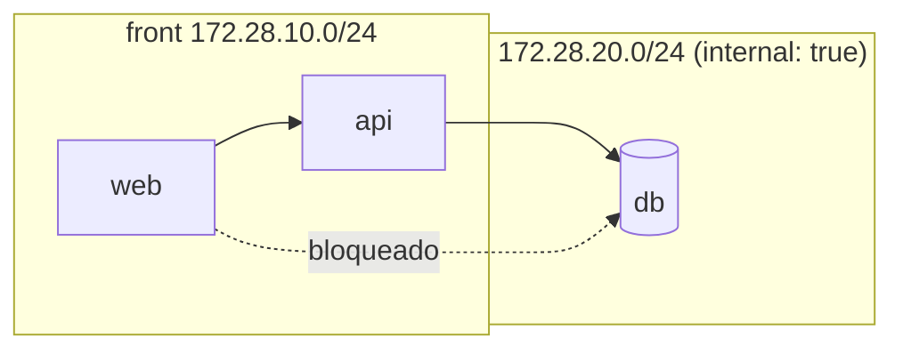

# Docker Swarm con Portainer - Parte 3: Segmentación de Redes (UTP Lab 14)

Laboratorio de **segmentación de red** dentro del clúster Swarm: pasar de una
**red plana** (todo se ve con todo) a **subredes `front`/`back`** con
`internal: true` y **DNS interno**. Basado en el Laboratorio N.º 14 de Redes de
Computadoras (UTP), adaptado de `docker compose` a **Docker Swarm**.

> **Archivos del proyecto que se usan aquí:**
> - `docker-compose-network.yml` — stack segmentado (dnsmasq / web / api / db)
> - `docker-compose-network-planos.yml` — versión de red plana (el problema)
> - `dnsmasq.conf` — zonas DNS internas (`web.local`, `api.local`, `db.local`)
> - `api/app.py` + `Dockerfile.api` — API Flask (`/ping`, `/db`, `/health`)
> - `scripts/verificar.sh` — verificación automática (7 pruebas)

## Objetivo

Demostrar por qué una red plana es insegura y cómo segmentarla:

| Antes (red plana) | Después (segmentada) |
|---|---|
| `web` alcanza `db` directo | `web` **no** alcanza `db` (ni por nombre ni por IP) |
| Sin zonas | `front` (pública) / `back` (`internal: true`) |
| Sin DNS propio | DNS interno: `web.local`, `api.local`, `db.local` |
| — | `api` es el único puente `front → back` |

## Topología



## Requisitos

```bash
docker --version && docker compose version
ss -ltn | grep -q ':8080' && echo "¡8080 ocupado!" || echo "puerto 8080 libre"
```

> **`docker compose` vs `docker stack deploy`:** este stack usa IPs estáticas
> (`ipv4_address`) y un contenedor `dnsmasq` para replicar el L14, y eso funciona
> con `docker compose`. En **Swarm**, `docker stack deploy` no admite IPs
> estáticas en redes overlay: allí se usa el DNS interno de servicios de Swarm
> (`<servicio>`) en lugar de `*.local`, y se omite el bloque `ipv4_address`.

## Paso 1 — La red plana (el problema)

```bash
# Levantar la versión insegura
docker compose -f docker-compose-network-planos.yml up -d

# Ver el problema: web y db comparten la misma red
docker compose -f docker-compose-network-planos.yml ps
curl -s -o /dev/null -w "web responde %{http_code}\n" http://localhost:8081
```

En la red plana, cualquier servicio alcanza a cualquier otro: la web puede llegar
directo a la base de datos. Eso es lo que hay que evitar.

## Paso 2 — Segmentar (front/back + DNS)

```bash
# Levantar el segmentado (puede convivir con el plano: proyectos distintos)
docker compose -f docker-compose-network.yml up -d
docker compose -f docker-compose-network.yml ps

# Si quieres dejar solo el segmentado:
docker compose -f docker-compose-network-planos.yml down -v --remove-orphans
```

### Estructura de `docker-compose-network.yml`:

- `dnsmasq` → solo red `front`, IP fija `172.28.10.53` (servidor DNS interno)
- `web` → solo red `front`, IP fija `172.28.10.10`, publica `8080:80`
- `api` → conectada a `front` (`.20`) **y** `back` (`.30`) — es el puente
- `db` → solo red `back`, IP fija `172.28.20.20` (sin acceso externo)

```yaml
networks:
  front:
    driver: bridge
    ipam:
      config:
        - subnet: 172.28.10.0/24
          gateway: 172.28.10.1
  back:
    driver: bridge
    internal: true          # <-- la clave del aislamiento
    ipam:
      config:
        - subnet: 172.28.20.0/24
          gateway: 172.28.20.1
```

Las IPs fijas deben coincidir con `dnsmasq.conf`.

## Paso 3 — Verificación manual

```bash
COMPOSE="docker compose -f docker-compose-network.yml"

# 1) web NO resuelve db por nombre
$COMPOSE exec web getent hosts db                    # sin salida

# 2) web NO alcanza db por IP
$COMPOSE exec web sh -c "nc -z -w 3 172.28.20.20 5432"   # timeout

# 3) api SÍ alcanza db (el puente)
$COMPOSE exec api python -c \
  "import socket as s; s.create_connection(('172.28.20.20',5432),3); print('API -> DB OK')"
```

## Paso 4 — Verificación automática (recomendada)

```bash
docker compose -f docker-compose-network.yml up -d
chmod +x scripts/verificar.sh
./scripts/verificar.sh
```

Debe terminar con **`Resultado: 7 OK, 0 FALLO`** (verificado en este proyecto).

### Salidas esperadas (referencia)

| Prueba | Resultado correcto |
|--------|--------------------|
| `web` → `db` por nombre | `getent` sin salida (no resuelve) |
| `web` → `172.28.20.20:5432` | `Operation timed out` (sin ruta) |
| `api` → `172.28.20.20:5432` | conecta |
| `nslookup web.local` @172.28.10.53 | `172.28.10.10` |
| `nslookup api.local` @172.28.10.53 | `172.28.10.20` |
| `nslookup db.local` @172.28.10.53 | `172.28.20.20` |
| `curl localhost:8080` | `HTTP 200` |

### Endpoints de la API (extra)

```bash
docker exec api python -c "import requests; print(requests.get('http://localhost:5000/health').text)"
# -> {"service":"api","status":"healthy"}

docker exec api python -c "import requests; print(requests.get('http://localhost:5000/ping').text)"
# -> {"message":"pong","service":"api running on db:5432"}

docker exec api python -c "import requests; print(requests.get('http://localhost:5000/db').text)"
# -> {"db":"reachable","host":"db","port":5432}
```

## Paso 5 — Gestión desde Portainer

1. Abre Portainer en `http://<IP_MAESTRO>:9000`
2. Ve a **Stacks** → verás el stack desplegado
3. Ve a **Networks** → confirma `front` y `back`
4. En **Services** revisa healthchecks y réplicas

## Paso 6 — Escalado (extra Swarm)

A diferencia del `docker compose` del L14, en Swarm puedes escalar la API:

```bash
docker service scale <stack>_api=5
docker service ps <stack>_api
```

O con el script del proyecto:

```bash
./scripts/demo-scaling.sh
```

## Errores frecuentes

| Síntoma | Causa | Solución |
|---------|-------|----------|
| `web` SÍ alcanza la DB | falta `internal: true` en `back` o la DB publica `ports:` | corregir el YAML y `up -d` |
| Los nombres DNS no resuelven | IP del servicio ≠ `dnsmasq.conf` | sincronizar IPs (`ipv4_address`) |
| `nslookup` da `connection timed out; no servers could be reached` desde otro contenedor (pero funciona con `127.0.0.1` dentro de dnsmasq) | `interface=0.0.0.0` en `dnsmasq.conf` (espera un nombre de interfaz, no una IP) → dnsmasq responde solo en loopback | quitar la línea `interface=` |
| Levantar el stack plano borra los contenedores del segmentado | mismo proyecto compose (nombre del directorio) y servicios `web`/`db` repetidos | cada archivo debe declarar su propio `name:` (ya incluido) |
| `port is already allocated` (8080/8081) | otro stack arriba | `docker compose down` del otro |
| `network ... already exists` / solapes | quedó otro stack levantado | `docker compose down -v` antes de subir |
| `nc: bad address` | `nc` sin `-w` (busybox) | usar `nc -z -w 3 <ip> <puerto>` |
| `docker stack deploy` falla con `ipv4_address` o `build:` | Swarm no admite IPs estáticas en overlay ni construir imágenes | usar `docker compose` para este stack |

## Limpieza

```bash
docker compose -f docker-compose-network.yml down -v --remove-orphans
docker compose -f docker-compose-network-planos.yml down -v --remove-orphans
```

## Entregable

- [ ] Stack con redes `front`/`back` (`back` con `internal: true`).
- [ ] Pruebas: `web ↛ db` (por nombre y por IP) y `api → db` OK.
- [ ] `web` responde `HTTP 200` en `localhost:8080`.
- [ ] Salida del `./scripts/verificar.sh` (7 OK, 0 FALLO).
- [ ] Captura de pantalla del stack y las redes en Portainer.
