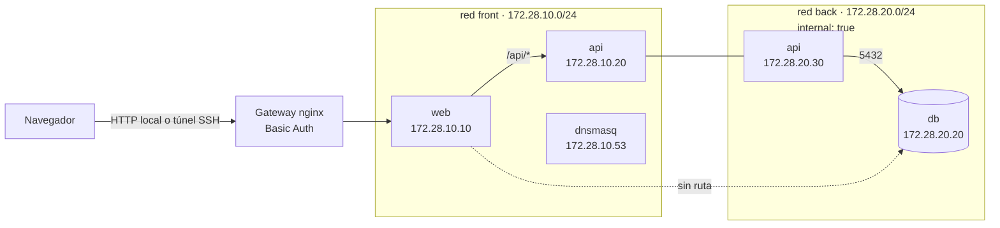

# 00 — Guía de réplica paso a paso

Esta es la guía pensada para **replicar el Laboratorio 14 desde cero**. Está
ordenada por pasos y cada paso termina con una comprobación. Si solo quieres
entender el diseño, empieza por [01 — Arquitectura](01-arquitectura.md).

> **Cloudflare Tunnel no es requisito.** El laboratorio se completa en la
> máquina del laboratorio o con un túnel SSH desde tu computadora. El túnel de
> Cloudflare del [paso 8](#paso-8--publica-con-cloudflare-tunnel-opcional-no-requerido)
> es una extensión opcional del entorno del docente; no lo necesitas para
> entregar ni para aprobar.

> **Tiempo estimado:** 60–90 minutos con dos máquinas Linux y Docker ya
> instalado.
>
> **Resultado esperado:** un clúster Swarm de dos nodos, Portainer, una app de
> tres capas (`web → api → db`) con la base de datos aislada, DNS interno y un
> gateway con Basic Auth. Al final, `./scripts/verificar.sh` debe dar
> **7 OK, 0 FALLO**.

## Qué vas a construir



La cadena es **navegador → gateway → `web` → `api` → `db`**. La API es el único
contenedor con una interfaz en cada red. `web` nunca se conecta a `back` y la
base de datos no publica puertos.

| Componente | Dónde corre | Para qué sirve |
|---|---|---|
| Swarm | maestro + worker | Orquesta el clúster y ejecuta Portainer |
| Portainer | maestro, `9001` | Interfaz web para administrar Docker |
| `web` | red `front` | Sirve la app y hace proxy `/api/` |
| `api` | `front` + `back` | Única capa que habla con la base de datos |
| `db` | red `back` | PostgreSQL, sin puerto publicado |
| `dnsmasq` | red `front` | Resuelve `web.local`, `api.local`, `db.local` |
| Gateway nginx | maestro, loopback | Basic Auth y proxy hacia la app/Portainer |

## Antes de empezar

### Lo que necesitas

- Dos máquinas Linux (físicas o virtuales) con **Docker Engine** y **Docker
  Compose v2**. Puedes usar una sola máquina para el maestro y otra para el
  worker.
- Al menos **2 GB de RAM** y **10 GB de disco** por nodo.
- Las máquinas deben verse por la red local (por ejemplo, `ping` entre ellas).
- Acceso `sudo` para instalar Docker y abrir puertos del firewall.
- **No necesitas** un dominio ni Cloudflare. Solo se mencionan como extensión
  opcional si quieres publicar la app en Internet.

Comprueba las versiones:

```bash
docker --version
docker compose version
```

### Valores de ejemplo

En esta guía se usan los valores del laboratorio real. **Reemplázalos por los
tuyos** cuando corresponda:

| Variable | Ejemplo | Qué es |
|---|---|---|
| `MANAGER_IP` | `172.25.208.103` | IP LAN del nodo maestro |
| `WORKER_IP` | `172.25.208.110` | IP LAN del nodo worker |
| `LAB_USER` | `lab14` | Usuario de Basic Auth |
| `GATEWAY_PASS` | *(privada)* | Contraseña de Basic Auth; no se escribe en el repo |
| Red `front` | `172.28.10.0/24` | Red de la app; puede quedarse igual |
| Red `back` | `172.28.20.0/24` | Red interna de la base de datos |

Las redes internas `172.28.10.0/24` y `172.28.20.0/24` se pueden conservar si no
chocan con tu red. Si las cambias, actualiza **a la vez**
[`docker-compose-network.yml`](../docker-compose-network.yml) y
[`dnsmasq.conf`](../dnsmasq.conf).

### Convenciones

- Los comandos se ejecutan en el **maestro** salvo que digan `# worker`.
- El símbolo `$` es el prompt; no lo escribas.
- Los valores entre `<...>` los reemplazas tú.
- No copies tokens de Swarm ni contraseñas a Git, al chat ni a la documentación.
- Si tu usuario no puede usar Docker, agrega `sudo` o configura el grupo
  `docker`.

## Paso 0 — Prepara el repositorio

Copia el repositorio en el maestro (o clónalo desde tu remoto) y entra a la
carpeta:

```bash
cd ~/docker-cluster-redes
chmod +x scripts/*.sh
```

Revisa que los puertos que usa el laboratorio estén libres:

```bash
ss -ltn | grep -E ':(8080|8081|8088|9000|9001|9090) ' \
  || echo "Puertos libres"
```

Si alguno está ocupado, detén el servicio o el stack anterior antes de seguir.
Los puertos `8080`/`8081` son de `web`, y `9000`/`8088`/`9090` del gateway.

**Comprobación:** `docker --version` y `docker compose version` responden sin
error, y los puertos están libres.

## Paso 1 — Inicializa Swarm en el maestro

```bash
export MANAGER_IP=172.25.208.103   # cambia por tu IP
docker swarm init --advertise-addr "$MANAGER_IP"
```

Guarda el comando `docker swarm join --token ...` que imprime la salida: lo
usarás en el worker. Si necesitas verlo otra vez:

```bash
docker swarm join-token worker
```

> **No publiques el token.** Si se filtra, rótalo con
> `docker swarm join-token --rotate worker`.

Comprueba el estado:

```bash
docker info --format 'swarm={{.Swarm.LocalNodeState}} manager={{.Swarm.ControlAvailable}} nodos={{.Swarm.Nodes}}'
```

Debe responder `swarm=active manager=true nodos=1` antes de unir el worker.

### Si usas firewall

En el maestro y en el worker, permite el tráfico de Swarm:

```bash
sudo ufw allow 2377/tcp    # administración del clúster
sudo ufw allow 7946/tcp    # descubrimiento entre nodos
sudo ufw allow 7946/udp
sudo ufw allow 4789/udp    # red overlay
```

No abras `8080`, `9000`, `8088` ni `9090` a Internet: están en loopback o
detrás del gateway.

## Paso 2 — Une el worker

En la máquina **worker**:

```bash
# worker
docker swarm join --token <TOKEN> 172.25.208.103:2377
```

Vuelve al maestro y verifica:

```bash
docker node ls
```

**Comprobación:** deben aparecer dos nodos `Ready`, uno con `Manager Status =
Leader` y el worker sin rol de manager.

```text
ID                            HOSTNAME       STATUS    AVAILABILITY   MANAGER STATUS
qwxje8515jzlaabeab1qzu9pn *   kernel-lab     Ready     Active         Leader
1z32d1kilxflg1com9tqeavdl     ubuntu24-cwl   Ready     Active
```

Si el worker no aparece, revisa la conectividad al `2377/tcp` y que el token no
haya expirado.

## Paso 3 — Despliega Portainer

```bash
docker stack deploy -c docker-compose-portainer.yml portainer
docker stack services portainer
```

**Comprobación:** el servicio `portainer_portainer` debe estar en `1/1` y
publicar `*:9001->9000/tcp`.

Abre en el navegador:

```text
http://<IP_DEL_MAESTRO>:9001/
```

La primera vez, Portainer pide crear el usuario administrador. Guarda esas
credenciales en un lugar seguro (por ejemplo, en un gestor de contraseñas). Si
usarás los scripts de este repositorio, guárdalas también en
`~/.config/lab14/credentials.txt` con modo `600`, usando este formato:

```text
Portainer (acceso directo)
  usuario: admin
  password: <TU_CLAVE_DE_PORTAINER>
```

Crea la carpeta si no existe y protege el archivo:

```bash
mkdir -p ~/.config/lab14
touch ~/.config/lab14/credentials.txt
chmod 600 ~/.config/lab14/credentials.txt
```

Los scripts leen de ahí sin imprimir la clave. Si la pantalla de creación inicial
ya no aparece, reinicia el servicio:

```bash
docker service update --force portainer_portainer
```

Comprueba la API:

```bash
curl -s http://127.0.0.1:9001/api/status
# {"Version":"2.45.3","InstanceID":"..."}
```

> El puerto `9000` **no** se usa para Portainer en este laboratorio: queda libre
> para el gateway. Portainer se publica en `9001`.

## Paso 4 — Levanta el stack segmentado

```bash
docker compose -f docker-compose-network.yml up -d --build
docker compose -f docker-compose-network.yml ps
```

**Comprobación:** `web`, `api` y `db` deben estar `Up (healthy)`, y `dnsmasq`
`Up`. La primera vez, la API se construye desde `Dockerfile.api`; puede tardar
un minuto.

```text
NAME      IMAGE                       STATUS
web       nginx:alpine                Up (healthy)   127.0.0.1:8080->80/tcp
api       lab14-segmentado-api        Up (healthy)   5000/tcp
db        postgres:13-alpine          Up (healthy)   5432/tcp
dnsmasq   4km3/dnsmasq:2.85-r2        Up             53/tcp, 53/udp
```

Comprueba la app directo en loopback:

```bash
curl -s -o /dev/null -w '%{http_code}\n' http://127.0.0.1:8080/
# 200

curl -s http://127.0.0.1:8080/api/db
# {"db":"reachable","host":"db","port":5432}
```

En este punto la app todavía **no** tiene Basic Auth: solo escucha en
`127.0.0.1:8080`. El gateway del paso 6 agrega la autenticación.

## Paso 5 — Verifica la segmentación

```bash
./scripts/verificar.sh
```

**Comprobación:** la salida debe terminar con:

```text
Resultado: 7 OK, 0 FALLO
```

Las siete pruebas son:

1. `web` no resuelve `db` por nombre.
2. `web` no alcanza `db` por IP.
3. `api` sí alcanza `db` por IP.
4. `nslookup web.local` → `172.28.10.10`.
5. `nslookup api.local` → `172.28.10.20`.
6. `nslookup db.local` → `172.28.20.20`.
7. `web` responde HTTP 200.

Si alguna falla, revisa [07 — Solución de problemas](07-solucion-problemas.md)
antes de continuar. El detalle de cada prueba está en
[03 — Redes y segmentación](03-redes-segmentacion.md).

## Paso 6 — Configura el gateway con Basic Auth

El gateway está versionado en [`infra/gateway/`](../infra/gateway/). Entra a esa
carpeta y crea el archivo de credenciales:

```bash
cd infra/gateway

# 1) Pide la contraseña sin mostrarla
read -r -s -p 'Clave para el usuario lab14: ' GATEWAY_PASS; echo

# 2) Genera el hash para nginx
docker run --rm httpd:alpine htpasswd -nbB lab14 "$GATEWAY_PASS" > .htpasswd

# 3) Guarda la contraseña solo para tu usuario
mkdir -p ~/.config/lab14
printf '%s' "$GATEWAY_PASS" > ~/.config/lab14/gateway.pass
chmod 600 .htpasswd ~/.config/lab14/gateway.pass

# 4) Levanta el gateway
docker compose up -d
```

Vuelve a la raíz del repositorio:

```bash
cd ../..
```

**Comprobación:** sin credenciales debe dar `401`; con credenciales, `200`:

```bash
GATEWAY_PASS=$(cat ~/.config/lab14/gateway.pass)

curl -s -o /dev/null -w 'sin auth  -> %{http_code}\n' http://127.0.0.1:9000/
curl -s -o /dev/null -w 'con auth  -> %{http_code}\n' \
  -u "lab14:$GATEWAY_PASS" http://127.0.0.1:9000/
curl -s -o /dev/null -w 'app local -> %{http_code}\n' \
  -u "lab14:$GATEWAY_PASS" http://127.0.0.1:8088/
curl -s -o /dev/null -w 'portainer -> %{http_code}\n' \
  -u "lab14:$GATEWAY_PASS" http://127.0.0.1:9090/portainer/
```

Salida esperada:

```text
sin auth  -> 401
con auth  -> 200
app local -> 200
portainer -> 200
```

> `.htpasswd` está en `.gitignore`. Nunca lo subas al repositorio. Si ya había
> otro gateway con el nombre `lab14-gateway`, detenlo antes:
> `docker rm -f lab14-gateway`.

Si editas `infra/gateway/nginx.conf`, recrea el contenedor:

```bash
cd infra/gateway
docker compose up -d --force-recreate gateway
cd ../..
```

## Paso 7 — Abre la app y Portainer (acceso local)

### Desde la misma máquina

| Qué | URL | Credenciales |
|---|---|---|
| App con Basic Auth | `http://127.0.0.1:8088/` | usuario `lab14` + tu contraseña |
| Portainer con Basic Auth | `http://127.0.0.1:9090/portainer/` | Basic Auth + login de Portainer |
| App directa (sin auth) | `http://127.0.0.1:8080/` | ninguna, solo loopback |
| Portainer directo | `http://127.0.0.1:9001/` | login de Portainer |

### Desde tu computadora

El gateway escucha solo en loopback. Abre un túnel SSH desde tu computadora:

```bash
ssh -L 8088:127.0.0.1:8088 \
    -L 9090:127.0.0.1:9090 \
    usuario@<IP_DEL_MAESTRO>
```

Luego abre `http://localhost:8088/` y `http://localhost:9090/portainer/`.
Portainer también está disponible en `http://<IP_DEL_MAESTRO>:9001/` desde la
red local.

En la app, prueba las pestañas **Infraestructura**, **Redes** y
**Desarrollo**. El estado se actualiza cada 4 segundos contra la API.


## Paso 8 — Publica con Cloudflare Tunnel (opcional, no requerido)

**No lo necesitas para completar el laboratorio.** Si no tienes dominio o no
quieres publicar la app en Internet, sáltate este paso: con el acceso local del
paso 7 (o el túnel SSH) ya tienes todo lo necesario. Esta sección documenta cómo
lo hizo el docente en su entorno, por si quieres repetirlo como extensión.

Si tienes un dominio en Cloudflare:

1. Crea un túnel en el panel de Cloudflare.
2. Agrega un *public hostname* para la app:
   - hostname: `app-red.<tu-dominio>`
   - servicio: `http://localhost:9000`
3. Agrega otro para Portainer:
   - hostname: `cluster-red.<tu-dominio>`
   - servicio: `http://localhost:9001`
4. Instala y ejecuta `cloudflared` en el maestro.
5. Comprueba:

```bash
GATEWAY_PASS=$(cat ~/.config/lab14/gateway.pass)

curl -s -o /dev/null -w '%{http_code}\n' https://app-red.<tu-dominio>/
# 401

curl -s -o /dev/null -w '%{http_code}\n' \
  -u "lab14:$GATEWAY_PASS" https://app-red.<tu-dominio>/
# 200
```

No abras puertos en el router: el túnel es saliente. Como segunda capa, agrega
**Cloudflare Access** (OTP por correo, Google, GitHub, etc.).

> `cluster-red` apunta directo al `9001`, así que solo lo protege el login de
> Portainer, no el Basic Auth. La alternativa con Basic Auth es
> `https://app-red.<tu-dominio>/portainer/`.

Los detalles y riesgos están en [05 — Gateway y túnel](05-gateway-tunel.md).

## Paso 9 — Genera tu evidencia

Si quieres las transcripciones y capturas como las de este repositorio:

```bash
./scripts/capturar-docs.sh --sin-pantallas   # solo texto
# o, si tienes Chrome y Node:
./scripts/capturar-docs.sh                   # texto + imágenes
```

Salida esperada:

```text
Salidas:   docs/salidas/ (9 archivos)
Capturas:  docs/capturas/ (17 imágenes)
```

La contraseña del gateway se lee de `~/.config/lab14/gateway.pass` o de
`$GATEWAY_PASS`. La de Portainer, de `~/.config/lab14/credentials.txt` o
`$PORTAINER_PASS`. Ninguna se escribe en `docs/`.

## Lista de control final

Marca cada punto antes de entregar:

| # | Comprobación | Resultado esperado |
|---|---|---|
| 1 | `docker node ls` | 2 nodos `Ready`, manager `Leader` |
| 2 | `docker stack services portainer` | `portainer_portainer` en `1/1` |
| 3 | Login de Portainer | entra con el usuario admin |
| 4 | `docker compose -f docker-compose-network.yml ps` | `web`, `api`, `db` en `healthy` |
| 5 | `./scripts/verificar.sh` | **7 OK, 0 FALLO** |
| 6 | `curl` al gateway sin credenciales | `401` |
| 7 | `curl` al gateway con credenciales | `200` |
| 8 | `http://127.0.0.1:8088/` | app completa |
| 9 | `http://127.0.0.1:9090/portainer/` | Portainer con Basic Auth |
| 10 | `docker network inspect lab14-segmentado_back` | `"Internal": true` |
| 11 | `docker ps` | `db` sin puerto publicado |
| 12 | `git status` | sin `.htpasswd` ni contraseñas |

## Si algo falla

| Síntoma | Causa probable | Dónde mirar |
|---|---|---|
| `port is already allocated` | otro stack usa `8080`/`8081` | Paso 0 y [07](07-solucion-problemas.md) |
| `web` en `unhealthy` | healthcheck con `localhost` e IPv6 | [07, caso 1](07-solucion-problemas.md) |
| `nslookup` con timeout | `interface=0.0.0.0` en dnsmasq | [07, caso 2](07-solucion-problemas.md) |
| `docker stack deploy` rechaza IPs o `build:` | Swarm no admite IPs estáticas en overlay | [07, caso 4](07-solucion-problemas.md) |
| Gateway responde `401` con la clave correcta | `.htpasswd` viejo o contenedor sin recrear | Paso 6 y [07, caso 13](07-solucion-problemas.md) |
| Gateway responde `502` | `web` o `api` caídos | `docker ps` y registros de `web`/`api` |
| Portainer no carga | bundles grandes o primera carga lenta | espera y recarga; revisa `docker logs` |
| La app no muestra la DB | `api` sin ruta a `db` | `./scripts/verificar.sh` |

## Limpieza

Cuando termines la práctica, puedes apagar todo. **Cuidado:** `down -v` borra
los datos de la base de datos y de Portainer.

```bash
# Stack del laboratorio (sin -v conserva los datos)
docker compose -f docker-compose-network.yml down

# Stack plano de demostración, si lo levantaste
docker compose -f docker-compose-network-planos.yml down

# Gateway
cd infra/gateway
docker compose down
cd ../..

# Portainer
docker stack rm portainer

# Salir del Swarm (primero el worker, después el maestro)
# docker swarm leave --force
```

## Para profundizar

| Página | Contenido |
|---|---|
| [01 — Arquitectura](01-arquitectura.md) | Componentes, topología y flujo de una petición |
| [02 — Despliegue](02-despliegue.md) | Secuencia real con salidas y evidencias |
| [03 — Redes y segmentación](03-redes-segmentacion.md) | `front`/`back`, DNS y las 7 pruebas |
| [04 — Aplicación visual](04-aplicacion.md) | Panel, pestañas, endpoints y validación |
| [05 — Gateway y túnel](05-gateway-tunel.md) | Basic Auth y puertos; el túnel es opcional |
| [06 — Operación](06-operacion.md) | Día a día, reinicios y respaldos |
| [07 — Solución de problemas](07-solucion-problemas.md) | Problemas reales y causa raíz |
| [08 — Pendientes](08-pendientes.md) | Entregable, riesgos y deuda técnica |
