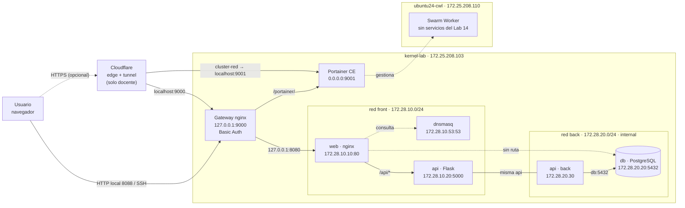
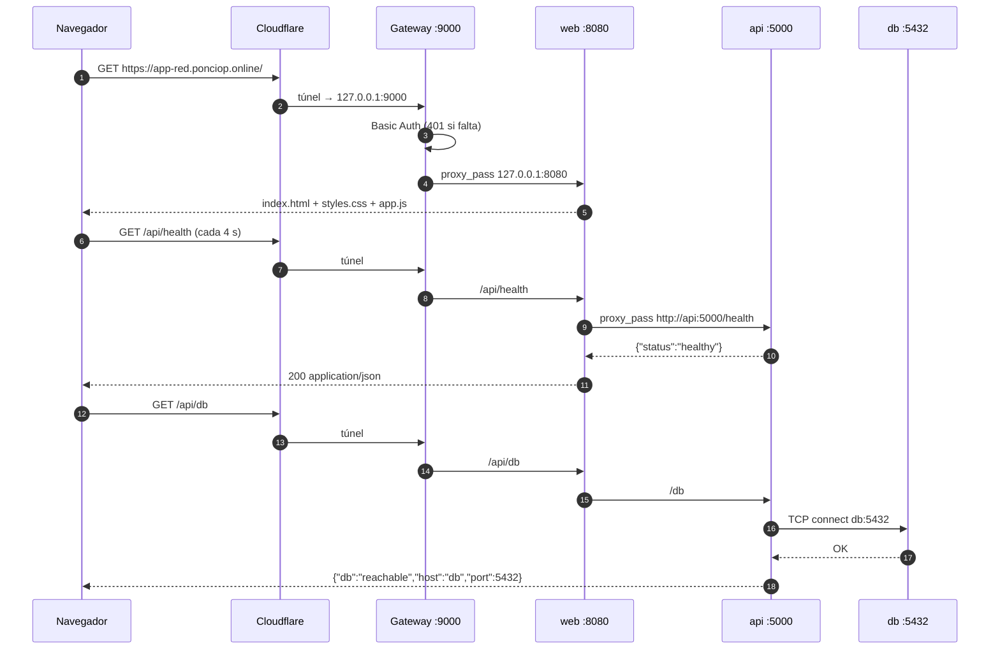

# 01 — Arquitectura

## Objetivo

Montar un clúster **Docker Swarm** con dos nodos, administrarlo con
**Portainer**, y desplegar una aplicación de tres capas (`web → api → db`) donde
la base de datos queda **aislada** en una red interna. La aplicación se publica
en loopback detrás de un gateway nginx con Basic Auth. En el entorno del docente
se añade, de forma **opcional**, un túnel de Cloudflare para el acceso público.

## Vista general

## Componentes

| Componente | Dónde corre | Imagen / versión | Responsabilidad |
|---|---|---|---|
| Swarm manager | `kernel-lab` (`172.25.208.103`) | Docker **29.8.1** | Leader del clúster; ejecuta Portainer, gateway y el stack |
| Swarm worker | `ubuntu24-cwl` (`172.25.208.110`) | Docker **29.1.3** | Nodo unido al clúster; sin tareas del Lab 14 |
| Portainer CE | manager, puerto host `9001` | `portainer/portainer-ce:latest` (2.45.3) | UI de administración del Swarm |
| Gateway nginx | manager, loopback `9000`, `8088`, `9090` | `nginx:alpine` | Basic Auth + proxy hacia app y Portainer |
| `web` | red `front`, `172.28.10.10` | `nginx:alpine` | Sirve la SPA y hace proxy `/api/` → `api:5000` |
| `api` | `front` `.20` + `back` `.30` | `lab14-segmentado-api` (Flask, Python 3.9.25) | Única capa con acceso a la DB |
| `db` | red `back`, `172.28.20.20` | `postgres:13-alpine` | Datos; sin puerto publicado |
| `dnsmasq` | red `front`, `172.28.10.53` | `4km3/dnsmasq:2.85-r2` | DNS de las zonas `.local` |
| Cloudflare Tunnel | servicio del host | remoto (versión 7) | **Opcional:** entrada pública del entorno del docente; el laboratorio funciona en local sin esto |

### Servicios del panel

La pestaña **Infraestructura** del panel cuenta **7 servicios**:
`Cloudflare Tunnel`, `Gateway nginx`, `Portainer`, `web`, `api`, `db` y
`dnsmasq`. Los dos nodos se muestran por separado. El túnel aparece porque el
panel documenta el entorno real del docente; **no es necesario replicarlo**.

## Flujo de una petición

Puntos clave:

1. El navegador **nunca** habla directo con la API ni con la DB: solo con el
   gateway. Sin túnel, entra por `127.0.0.1:8088` o por un túnel SSH.
2. `web` conoce a `api` por el nombre de servicio de Docker (`api:5000`).
3. `api` conoce a `db` por el nombre de servicio (`db:5432`).
4. `web` **no** está conectada a `back`: no tiene interfaz ni ruta hacia
   `172.28.20.0/24`.
5. La DB no publica `ports:` y su red es `internal: true`.

> El diagrama de secuencia muestra el flujo por el dominio público. Es el mismo
> recorrido que en local, solo que sin Cloudflare: navegador → gateway → `web` →
> `api` → `db`.

## Puertos y exposición

| Puerto | Interfaz | Qué es | ¿Público? |
|---|---|---|---|
| `443` | Cloudflare | Entrada HTTPS | solo si publicas (opcional) |
| `9000` | `127.0.0.1` | Gateway: entrada del túnel | solo túnel/local |
| `8088` | `127.0.0.1` | App a través del gateway | solo local |
| `9090` | `127.0.0.1` | Portainer a través del gateway | solo local |
| `9001` | `0.0.0.0` + `[::]` | Portainer directo | LAN y túnel `cluster-red` |
| `8080` | `127.0.0.1` | `web` sin auth | solo local |
| `8081` | `127.0.0.1` | `web-planos` (demo de red plana) | solo local |
| `2377/tcp` | LAN | Swarm management | red privada |
| `7946/tcp,udp` | LAN | Gossip de Swarm | red privada |
| `4789/udp` | LAN | Overlay de Swarm | red privada |
| `5000` | interna | API Flask | no publicado |
| `5432` | interna | PostgreSQL | no publicado |
| `53` | interna | dnsmasq | no publicado |
| `8000` | contenedor | Edge de Portainer | **no mapeado** |

Evidencia: [`salidas/entorno.txt`](salidas/entorno.txt) y
[`terminal-entorno.png`](capturas/terminal-entorno.png).

## Decisiones de diseño

| Decisión | Motivo |
|---|---|
| `back` con `internal: true` | Elimina la ruta externa y el gateway de la red; solo los miembros de `back` se ven entre sí |
| Solo `api` en las dos redes | Es el puente controlado; `web` no puede saltarse la API |
| `web` sin `ports:` públicos | Solo se publica en `127.0.0.1:8080`; el exterior entra por el gateway |
| Gateway en loopback | El túnel es saliente; no se abren puertos en el router ni en la LAN |
| Basic Auth en el gateway | Segunda barrera antes de la app y de `/portainer/` |
| Portainer en `9001` | Evita chocar con el gateway (`9000`) y mantiene su propio login |
| `cluster-red` directo a `9001` | Solo si se publica con Cloudflare; decisión explícita para no mover Portainer, se acepta que no pase por Basic Auth |
| Stack segmentado con `docker compose` | Se necesitan IPs fijas y `build:`; `docker stack deploy` no los admite en overlay |
| App sin frameworks | Cero dependencias, se sirve como estáticos y se puede cachear/versionar con `?v=` |

## Diferencias con Swarm puro

El stack del laboratorio (`docker-compose-network.yml`) **no** se despliega con
`docker stack deploy`:

- Swarm no acepta `ipv4_address` en redes overlay.
- Swarm no construye imágenes (`build:`); la API usa un Dockerfile local.
- El DNS de Swarm resuelve `<servicio>` pero no las zonas `.local` de dnsmasq.

Por eso conviven dos mundos:

- **Swarm** administra nodos y Portainer (`docker stack deploy`).
- **Docker Compose** levanta el stack segmentado del L14 en el manager.

## Evidencia visual

| Diagrama del panel | Portainer |
|---|---|
|  |  |

Portainer autenticado: [`07-portainer-servicios.png`](capturas/07-portainer-servicios.png)
y [`08-portainer-redes.png`](capturas/08-portainer-redes.png).

El diagrama completo del panel, con todos los nodos y flujos, está en
[`01-panel-escritorio.png`](capturas/01-panel-escritorio.png).
