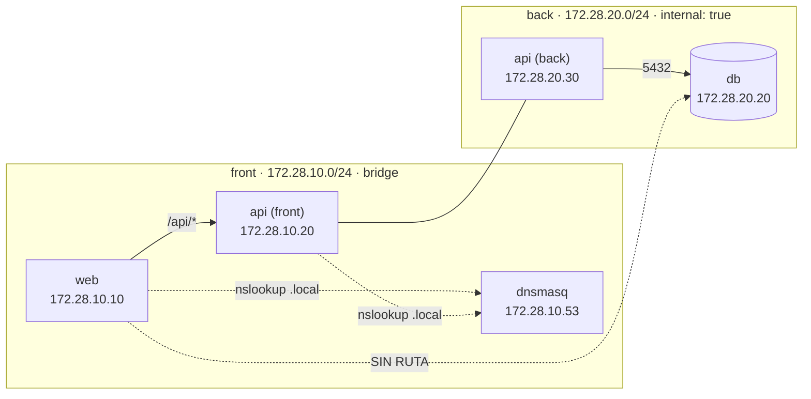

# 03 — Redes y segmentación

## Topología



`api` es el **único** contenedor con una interfaz en cada red. Esa es toda la
superficie de contacto entre `front` y `back`.

## Redes

| Red | Subred | Gateway IPAM | `internal` | Miembros |
|---|---|---|---|---|
| `lab14-segmentado_front` | `172.28.10.0/24` | `172.28.10.1` | `false` | `web .10`, `api .20`, `dnsmasq .53` |
| `lab14-segmentado_back` | `172.28.20.0/24` | `172.28.20.1` | **`true`** | `api .30`, `db .20` |

Salida real:

```text
red lab14-segmentado_front   driver=bridge   internal=false
  subred 172.28.10.0/24   gateway 172.28.10.1
  miembros:
    dnsmasq  172.28.10.53/24
    web      172.28.10.10/24
    api      172.28.10.20/24

red lab14-segmentado_back    driver=bridge   internal=true
  subred 172.28.20.0/24   gateway 172.28.20.1
  miembros:
    api  172.28.20.30/24
    db   172.28.20.20/24
```

Evidencia: [`salidas/redes.txt`](salidas/redes.txt) ·
[`terminal-redes.png`](capturas/terminal-redes.png).

> Aunque `back` muestra una “gateway” de IPAM (`172.28.20.1`), al ser
> `internal: true` Docker **no** le da salida al exterior ni la convierte en
> ruta por defecto. Los contenedores de `back` solo hablan entre ellos; para
> salir necesitarían otra red, como hace `api` con `front`.

## Matriz de alcance

| Origen | Destino | ¿Puede? | Por qué |
|---|---|---|---|
| `web` | `db` por nombre | **no** | `db` no está en `front`; el DNS embebido de Docker no lo conoce |
| `web` | `172.28.20.20:5432` | **no** | `web` no tiene interfaz en `back`; no hay ruta |
| `api` | `db` por nombre | **sí** | `api` está en `back` y Docker resuelve el servicio `db` |
| `api` | `172.28.20.20:5432` | **sí** | Interfaz `172.28.20.30` en la misma subred |
| `db` | Internet | **no** | `back` es interna y la DB no publica puertos |
| Gateway | `web:8080` | **sí** | Publicación en loopback |
| Gateway | `api:5000` | **indirecto** | Solo a través del proxy `/api/` de `web` |

## DNS interno

Docker trae su propio resolver (`127.0.0.11`) para nombres de **servicio**
(`web`, `api`, `db`) dentro de cada red. El laboratorio añade un DNS explícito
para las zonas `.local`, servido por `dnsmasq`:

| Registro | IP | Miembro de |
|---|---|---|
| `web.local` | `172.28.10.10` | `front` |
| `api.local` | `172.28.10.20` | `front` |
| `db.local` | `172.28.20.20` | `back` |
| `dns.local` | `172.28.10.53` | `front` |

Configuración: [`dnsmasq.conf`](../dnsmasq.conf). Las IPs deben coincidir
**exactamente** con `docker-compose-network.yml`; si cambias una, actualiza la
otra.

```bash
docker exec web nslookup api.local 172.28.10.53
docker exec api nslookup db.local 172.28.10.53
```

```text
Server:  172.28.10.53
Name:    api.local
Address: 172.28.10.20

Server:  172.28.10.53
Name:    db.local
Address: 172.28.20.20
```

No se define `db.local` para `web`: aunque `web` podría consultar al DNS y
obtener la IP, **no tiene ruta** hacia `172.28.20.0/24`. El aislamiento es de
red, no solo de nombres.

## Las 7 pruebas

`scripts/verificar.sh` automatiza el entregable:

| # | Prueba | Resultado real |
|---|---|---|
| 1 | `web` no resuelve `db` por nombre | ✅ `getent hosts db` vacío |
| 2 | `web` no alcanza `db` por IP | ✅ `nc` falla con timeout/exit 1 |
| 3 | `api` alcanza `db` por IP | ✅ `nc` exit 0 |
| 4 | `nslookup web.local` | ✅ `172.28.10.10` |
| 5 | `nslookup api.local` | ✅ `172.28.10.20` |
| 6 | `nslookup db.local` | ✅ `172.28.20.20` |
| 7 | `web` responde HTTP 200 | ✅ `127.0.0.1:8080` |

```text
kernel@kernel-lab:~/docker-cluster-redes$ ./scripts/verificar.sh
🔍 Verificando segmentación y DNS...
==================================
1) web no resuelve db por nombre... ✅ OK
2) web no alcanza db por IP... ✅ OK
3) api alcanza db por IP... ✅ OK
4) nslookup web.local... ✅ OK
5) nslookup api.local... ✅ OK
6) nslookup db.local... ✅ OK
7) web responde HTTP 200... ✅ OK

==================================
Resultado: 7 OK, 0 FALLO
```

Evidencia: [`salidas/segmentacion.txt`](salidas/segmentacion.txt) ·
[`terminal-segmentacion.png`](capturas/terminal-segmentacion.png).

### Pruebas manuales

```bash
# 1) web no resuelve db
docker exec web getent hosts db || echo "(vacío: db no resuelve desde web)"
# (vacío: db no resuelve desde web)

# 2) web no alcanza db por nombre
docker exec web sh -c "nc -z -w 2 db 5432; echo exit=\$?"
# nc: bad address 'db'
# exit=1

# 3) web no alcanza db por IP
docker exec web sh -c "nc -z -w 2 172.28.20.20 5432; echo exit=\$?"
# exit=1

# 4) api sí alcanza db
docker exec api sh -c "nc -z -w 2 db 5432; echo exit=\$?"
# exit=0
```

## Cómo se construye el aislamiento

1. **Sin interfaz compartida:** `web` solo se conecta a `front`; no existe una
   ruta IP hacia `172.28.20.0/24`.
2. **`internal: true`:** la red `back` no tiene salida externa ni NAT; limita a
   `api` y `db` a hablarse entre sí.
3. **Sin `ports:` en `db`:** no hay publicación al host ni al exterior.
4. **Proxy explícito:** la única forma de llegar a la DB es `/api/db`, que
   ejecuta un `connect` desde `api`.
5. **Healthchecks:** `db` usa `pg_isready`; `api` consulta `/health`; `web`
   consulta `127.0.0.1`. Si un servicio no está sano, el resto lo nota.

## Comportamiento ante fallos

| Situación | Efecto esperado |
|---|---|
| Se cae `db` | `/api/db` responde `503` con `{"db":"unreachable"}`; la app muestra DB en rojo |
| Se cae `api` | `web` devuelve `502` en `/api/*`; la app muestra el banner de API caída |
| Se cae `web` | El gateway devuelve `502`; no hay app |
| Se cae el gateway | `8088` y `9090` dejan de responder; `8080` sigue disponible en loopback. Si publicaste, el túnel devuelve `502` |
| Se cae el túnel (solo si lo usas) | La app deja de ser accesible desde Internet; el acceso local sigue funcionando |

## Advertencia sobre el stack plano

`docker-compose-network-planos.yml` levanta `web-planos` y `db-planos` **en la
misma red**, que es el “problema” que el laboratorio demuestra: ahí `web-planos`
sí alcanza la DB. Ambos stacks conviven porque cada archivo declara su propio
`name:` (`lab14-plano` y `lab14-segmentado`), lo que evita que los servicios
`web`/`db` colisionen.

Si no necesitas la demo del problema:

```bash
docker compose -f docker-compose-network-planos.yml down -v --remove-orphans
```
