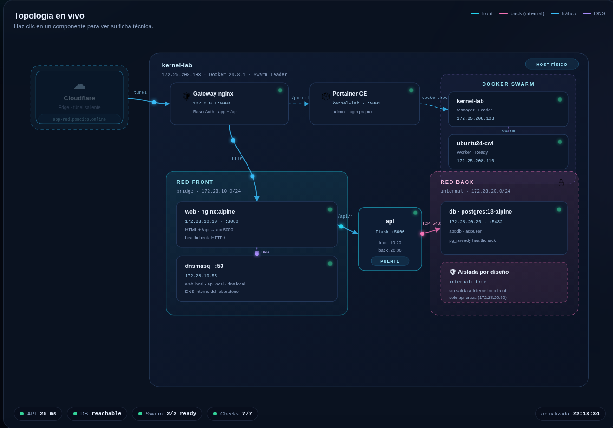

# 04 — Aplicación visual

## Qué es

Una SPA estática (HTML + CSS + JavaScript, **sin frameworks**) que se sirve
desde el contenedor `web` y muestra el laboratorio en vivo. El navegador solo
habla con el gateway; la app consulta la API a través del proxy `/api/` de
`web`.

| Archivo | Líneas | Rol |
|---|---|---|
| [`web/index.html`](../web/index.html) | 317 | Estructura, diagrama SVG y botones |
| [`web/styles.css`](../web/styles.css) | 598 | Tema oscuro, animaciones, responsive |
| [`web/app.js`](../web/app.js) | 620 | Datos del lab, render, polling y eventos |
| [`web/nginx.conf`](../web/nginx.conf) | 24 | Estático + proxy `/api/` → `api:5000` |

## Vistas

### Infraestructura


- Diagrama SVG animado: Cloudflare → gateway → web → api → db, con paquetes en
  movimiento, la red `front`, la red `back` (candado) y dnsmasq.
- Tarjetas del clúster (`kernel-lab` Leader, `ubuntu24-cwl` Worker).
- Siete servicios: túnel, gateway, Portainer, web, api, db y dnsmasq.
- Runtime de la API en vivo: hostname, Python, uptime, target de DB e IPs.
- Contadores animados: 2 nodos, 7 servicios, 2 redes, 7/7 pruebas.

### Redes


- Tarjetas de `front` (bridge) y `back` (`internal: true`) con subred, gateway
  y miembros.
- Tabla de DNS interno (`web.local`, `api.local`, `dns.local`, `db.local`).
- Lista de las 7 pruebas de segmentación.
- “Reglas de oro” que resumen lo que nunca debe romperse.

### Desarrollo


- Stack de desarrollo: frontend, API, datos y entrega.
- Tabla de endpoints con estado en vivo y latencia.
- Recorrido de una petición (`navegador → Cloudflare → gateway → web → api → db`).
- Config del proxy de `web`.
- JSON vivo con las respuestas reales de `/api/db` y `/api/info`.

### Móvil


La captura se tomó a **390 × 844** (viewport de teléfono). El layout pasa a una
columna, el diagrama se escala y no hay overflow horizontal.

### Diagrama aislado



## Datos y estado en vivo

La app declara la topología en `const TOPOLOGY` (`web/app.js`) y pide tres
endpoints cada **4 segundos**:

| Endpoint | Destino | Devuelve |
|---|---|---|
| `GET /api/health` | `api:5000/health` | `{"service":"api","status":"healthy"}` |
| `GET /api/db` | `api:5000/db` | `{"db":"reachable","host":"db","port":5432}` |
| `GET /api/info` | `api:5000/info` | hostname, Python, uptime, IPs y target |

Respuesta real de `/api/info`:

```json
{
  "back_ip": "172.28.20.30",
  "db_target": "db:5432",
  "front_ip": "172.28.10.20",
  "hostname": "587ac12aaa93",
  "platform": "Linux",
  "python": "3.9.25",
  "server_time": "2026-10-25T22:16:00Z",
  "service": "api",
  "uptime_seconds": 2921.1
}
```

Evidencia: [`salidas/api.txt`](salidas/api.txt) ·
[`terminal-api.png`](capturas/terminal-api.png).

### Comportamiento del polling

| Situación | Comportamiento |
|---|---|
| Primer arranque | `poll()` inmediato al `DOMContentLoaded` |
| Normal | `setTimeout` de 4 s, sin solapar peticiones |
| Pestaña oculta | No consulta; al volver (`visibilitychange`) refresca al instante |
| Timeout | `AbortController` a los 5 s |
| API caída | Punto rojo, chips “sin respuesta”; el banner aparece tras **2 fallos** seguidos |
| API recuperada | El banner se oculta en cuanto `health.ok` vuelve a `true` |
| Reintento manual | Botón “Reintentar” ejecuta `poll()` y muestra el resultado |

El fix del banner está en `web/styles.css` (`.banner[hidden] { display: none }`)
y se validó bloqueando `/api/*` en el navegador: oculto → visible a los 2
fallos → oculto al restaurar. Se versionó con `?v=2` para evitar caché vieja.

## Interacción

| Acción | Resultado |
|---|---|
| Clic en una pestaña | Cambia el panel y actualiza `aria-selected` |
| Clic en un nodo del SVG | Salta a su ficha, cambia de pestaña si hace falta y la resalta |
| `Enter` / `Espacio` en un nodo | Igual que el clic (los nodos son `role="button"` y `tabindex="0"`) |
| “Pausar animación” | Detiene SMIL y animaciones CSS; el botón pasa a “Reanudar” |
| Reloj | Se actualiza cada segundo (zona `es-PE`, 24 h) |
| Contadores | Animación de 900 ms; el contador de pruebas sube hasta 7/7 |

## Validación realizada

Se automatizó con Chrome DevTools Protocol durante el desarrollo:

| Área | Comprobaciones | Resultado |
|---|---|---|
| Pestañas | 3 pestañas cambian su panel y `aria-selected` | OK |
| Nodos | clic y teclado en los 9 nodos del SVG | OK |
| Animación | pausa/reanudación y textos del botón | OK |
| Contadores | valores finales 2, 7, 2, 7/7 | OK |
| Banner | oculto → visible a los 2 fallos → oculto al recuperar | OK |
| Responsive | sin overflow horizontal a 390 px | OK |
| **Total** | **21 comprobaciones** | **21 OK, 0 fallos** |

## Capturas reproducibles

```bash
# App de escritorio, redes, desarrollo, diagrama, móvil y Portainer
BASIC_AUTH="$GATEWAY_USER:$GATEWAY_PASS" \
  node scripts/docs/capturar-pantallas.js \
  --out docs/capturas \
  --app http://127.0.0.1:9000 \
  --portainer http://127.0.0.1:9001
```

O todo de una vez:

```bash
./scripts/capturar-docs.sh
```

Detalles de implementación:

- Chrome se lanza headless con `--remote-debugging-port=9333`.
- `scripts/docs/cdp.js` implementa el cliente WebSocket/TCP sin dependencias.
- `Page.getLayoutMetrics` da la altura real de la página; las capturas se hacen
  con `captureBeyondViewport`.
- La app se captura con Basic Auth vía `Network.setExtraHTTPHeaders`.
- Portainer se captura por loopback: sus bundles superan los 10 MB y por el
  túnel el headless no llega a la pantalla de login en el presupuesto de espera.
  La captura documenta el login; el acceso real sigue siendo el túnel.

## Editar la app

`web/` está montado en el contenedor `web` en solo lectura, así que basta con
editar y recargar:

```bash
# editar web/app.js, web/styles.css o web/index.html
curl -s -o /dev/null -w '%{http_code}\n' http://127.0.0.1:8080/
```

Si cambias CSS/JS y el navegador conserva caché, sube el `?v=` en
`web/index.html`:

```html
<link rel="stylesheet" href="styles.css?v=3">
<script src="app.js?v=3"></script>
```

No hace falta reconstruir la imagen de `web`: solo se reinicia el contenedor si
cambia `web/nginx.conf`.

## Limitaciones conocidas

- Los datos de topología son **declarativos**: si cambias IPs o servicios,
  actualiza `TOPOLOGY` en `app.js` además de los compose.
- El estado real solo cubre `health`, `db` e `info`; el resto de tarjetas son
  descriptivas.
- La app no se autentica: la protección la pone el gateway (Basic Auth). El
  acceso directo a `127.0.0.1:8080` no pide credenciales, pero solo está en
  loopback.
