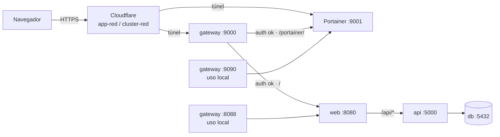

# 05 — Gateway y túnel

## Por qué existe

El laboratorio no debe exponer `web`, la API, la DB ni Portainer directamente a
Internet. El gateway concentra la entrada en **loopback**, aplica **Basic Auth**
y decide a qué upstream va cada ruta. Cloudflare Tunnel es el único camino
público y es **saliente**: no requiere abrir puertos en el router.



## Archivos

El gateway **no** vive en este repositorio; está en `~/lab14-gateway`:

```text
~/lab14-gateway/
├── docker-compose.yml    # nginx:alpine con network_mode: host
├── nginx.conf            # 9000 / 8088 / 9090 + Basic Auth
├── .htpasswd             # usuario lab14 (hash; no se versiona)
└── README.md             # mapa de puertos y flujo
```

La contraseña en claro **no** está en `.htpasswd` (solo el hash) ni en el
repositorio. Está en `~/.config/lab14/gateway.pass` y
`~/.config/lab14/credentials.txt`, ambos con modo `600`.

## Mapa de puertos

| Escucha | Ruta | Upstream | Auth | Uso |
|---|---|---|---|---|
| `127.0.0.1:9000` | `/` | `127.0.0.1:8080` | Basic | Entrada del túnel `app-red` |
| `127.0.0.1:9000` | `/portainer/` | `127.0.0.1:9001` | Basic | Portainer por el túnel |
| `127.0.0.1:8088` | `/` | `127.0.0.1:8080` | Basic | App en local |
| `127.0.0.1:9090` | `/portainer/` | `127.0.0.1:9001` | Basic | Portainer en local |
| `0.0.0.0:9001` | `/` | — | Login de Portainer | Portainer directo (LAN y `cluster-red`) |
| `127.0.0.1:8080` | `/` | — | **sin auth** | `web` directo (solo loopback) |

Comprobación de sockets reales:

```text
LISTEN 0 4096       0.0.0.0:9001   0.0.0.0:*
LISTEN 0  511     127.0.0.1:8088   0.0.0.0:*
LISTEN 0 4096     127.0.0.1:8081   0.0.0.0:*
LISTEN 0 4096     127.0.0.1:8080   0.0.0.0:*
LISTEN 0  511     127.0.0.1:9000   0.0.0.0:*
LISTEN 0  511     127.0.0.1:9090   0.0.0.0:*
LISTEN 0 4096         [::]:9001      [::]:*
```

## Configuración clave

Entrada del túnel:

```nginx
server {
    listen 127.0.0.1:9000;
    auth_basic           "Lab 14";
    auth_basic_user_file /etc/nginx/.htpasswd;

    location = /portainer { return 301 /portainer/; }

    location /portainer/ {
        proxy_pass http://127.0.0.1:9001/;   # quita el prefijo
        proxy_http_version 1.1;
        proxy_set_header Upgrade $http_upgrade;
        proxy_set_header Connection "upgrade";
        proxy_set_header X-Forwarded-Prefix /portainer;
        proxy_read_timeout 3600;             # websockets de Portainer
        proxy_buffering off;
    }

    location / {
        proxy_pass http://127.0.0.1:8080;
        proxy_http_version 1.1;
        proxy_set_header Host $host;
        proxy_set_header X-Real-IP $remote_addr;
        proxy_set_header X-Forwarded-For $proxy_add_x_forwarded_for;
        proxy_set_header X-Forwarded-Proto $scheme;
    }
}
```

Los bloques `8088` y `9090` son copias locales del mismo patrón, con su propio
`auth_basic`. `network_mode: host` permite que nginx escuche en el loopback del
host sin publicar puertos.

## Autenticación

Pruebas reales:

```bash
curl -s -o /dev/null -w '%{http_code}\n' http://127.0.0.1:9000/                       # 401
curl -s -o /dev/null -w '%{http_code}\n' -u "$GATEWAY_USER:$GATEWAY_PASS" \
     http://127.0.0.1:9000/                                                          # 200
curl -s -o /dev/null -w '%{http_code}\n' -u "$GATEWAY_USER:$GATEWAY_PASS" \
     http://127.0.0.1:8088/                                                          # 200
curl -s -o /dev/null -w '%{http_code}\n' -u "$GATEWAY_USER:$GATEWAY_PASS" \
     http://127.0.0.1:9090/portainer/                                                # 200
curl -s -o /dev/null -w '%{http_code}\n' https://app-red.ponciop.online/             # 401
curl -s -o /dev/null -w '%{http_code}\n' -u "$GATEWAY_USER:$GATEWAY_PASS" \
     https://app-red.ponciop.online/                                                 # 200
```

Evidencia: [`salidas/gateway.txt`](salidas/gateway.txt) ·
[`terminal-gateway.png`](capturas/terminal-gateway.png).

El usuario que aparece en los logs de `web` es `lab14`, inyectado por el
gateway en el `Authorization`; el navegador nunca ve la contraseña de la API
(la API no tiene auth propia porque no está publicada).

### Crear o rotar la contraseña

```bash
cd ~/lab14-gateway

# Nueva contraseña (no se imprime en pantalla si usas read -s)
read -r -s -p 'Nueva clave: ' GATEWAY_PASS; echo
docker run --rm httpd:alpine htpasswd -nbB lab14 "$GATEWAY_PASS" > .htpasswd

# Guardar para los scripts de documentación
printf '%s' "$GATEWAY_PASS" > ~/.config/lab14/gateway.pass
chmod 600 .htpasswd ~/.config/lab14/gateway.pass ~/.config/lab14/credentials.txt

docker compose up -d --force-recreate gateway
```

## Túnel de Cloudflare

El túnel se administra de forma remota (panel de Cloudflare, *remotely
managed*), versión de configuración **7**. En el host corre el servicio
`cloudflared`; no hay que abrir `443` en el router.

| Public hostname | Servicio local | Protección | Qué sirve |
|---|---|---|---|
| `app-red.ponciop.online` | `http://localhost:9000` | Basic Auth + TLS | App y `/api/*` |
| `cluster-red.ponciop.online` | `http://localhost:9001` | Solo login de Portainer | UI de Portainer |

```bash
# La app pública exige auth
curl -s -o /dev/null -w '%{http_code}\n' https://app-red.ponciop.online/   # 401

# La cadena completa devuelve datos reales
curl -s -u "$GATEWAY_USER:$GATEWAY_PASS" https://app-red.ponciop.online/api/db
# {"db":"reachable","host":"db","port":5432}
```

Cabeceras de la respuesta pública:

```text
HTTP/2 200
content-type: application/json
content-length: 37
server: cloudflare
cf-cache-status: DYNAMIC
```

El túnel no cachea la API (`DYNAMIC`); cada consulta llega al gateway.

## Portainer

| Acceso | URL | Auth |
|---|---|---|
| Público | `https://cluster-red.ponciop.online/` | login de Portainer |
| LAN | `http://172.25.208.103:9001/` | login de Portainer |
| Local con Basic Auth | `http://127.0.0.1:9090/portainer/` | Basic + login |
| Túnel con Basic Auth | `https://app-red.ponciop.online/portainer/` | Basic + login (no es el hostname principal) |


Las capturas se tomaron por loopback (`127.0.0.1:9001`) porque Portainer carga
~13 MB de JavaScript y, a través del túnel, el navegador headless no llegaba al
formulario en 45 s. En local la SPA carga en ~2,1 s. El acceso documentado para
personas sigue siendo `https://cluster-red.ponciop.online/`.

### Servicios y redes (sesión iniciada)

| Servicios del Swarm | Redes del laboratorio |
|---|---|
|  |  |

`07-portainer-servicios.png` muestra `portainer_portainer` en estado
`replicated 1/1`, con el puerto `9001:9000` y el stack `portainer`.
`08-portainer-redes.png` muestra `lab14-segmentado_front`,
`lab14-segmentado_back` (con `internal: true`) y `lab14-plano_plana`.

> La vista **Stacks** de Portainer puede aparecer vacía: el stack se desplegó
> con `docker stack deploy` desde la CLI y Portainer no lo registró en su base
> de datos (`/api/stacks` devuelve `[]`). Los **servicios** y las **redes** sí
> se leen directamente del endpoint de Docker (`primary`), por eso son la
> evidencia usada.

Las capturas autenticadas se generan con `scripts/docs/capturar-pantallas.js`:
el script rellena el formulario React con el setter nativo, espera la sesión,
filtra por `portainer` / `lab14` y captura a 1440 × 900. La contraseña se pasa
por `PORTAINER_PASS` y no se imprime.

Evidencia cruda de la API: [`salidas/portainer.txt`](salidas/portainer.txt) ·
[`terminal-portainer.png`](capturas/terminal-portainer.png). Ahí se ve
`/api/stacks` → `[]`, el endpoint `primary` y las redes con su subred e
`internal`.

## Riesgos y decisiones

| Tema | Estado | Comentario |
|---|---|---|
| `cluster-red` sin Basic Auth | **Aceptado** | Apunta directo a `9001`; solo protege el login de Portainer. Se decidió no mover Portainer |
| `9001` en `0.0.0.0` | **Aceptado** | Portainer es alcanzable desde la LAN y por IPv6. El resto de puertos está en loopback |
| Cloudflare Access | **Pendiente** | No hay API token ni `cert.pem`; se puede añadir OTP/SSO desde el panel |
| Credenciales | OK | Archivos modo `600`; no están en Git. Rotar si se comparten |
| `portainer/portainer-ce:latest` | Deuda | El tag flotante puede actualizar sin querer; fijar versión en el compose |
| Gateway fuera del repo | Deuda | `~/lab14-gateway` no se versiona; conviene copiarlo a `infra/gateway/` |

## Diagnóstico rápido

```bash
# ¿Escucha el gateway?
ss -ltnp | grep -E ':(9000|8088|9090) '

# ¿Responde el upstream?
curl -s -o /dev/null -w '%{http_code}\n' http://127.0.0.1:8080/
curl -s -o /dev/null -w '%{http_code}\n' http://127.0.0.1:9001/

# ¿El auth funciona?
curl -s -D - -o /dev/null http://127.0.0.1:9000/ | head -3
curl -s -D - -o /dev/null -u "$GATEWAY_USER:$GATEWAY_PASS" http://127.0.0.1:9000/ | head -3

# Logs del gateway (nginx escribe a stdout/stderr)
docker logs -f lab14-gateway
```

Si el túnel devuelve `502`, revisa en este orden: `cloudflared` → gateway
(`9000`) → `web` (`8080`). Si `8080` responde pero `9000` no, el problema es el
gateway o su auth. Si `9000` responde pero el túnel no, el problema es
Cloudflare.
