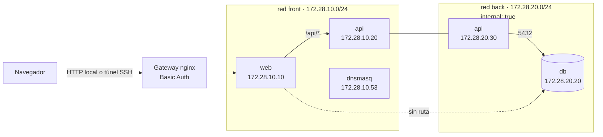
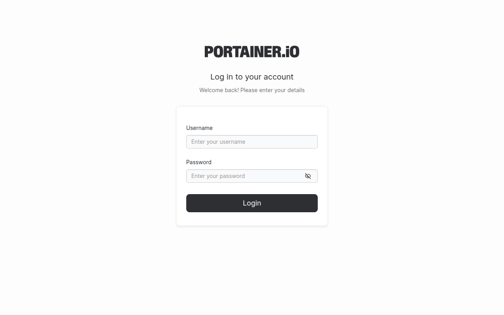
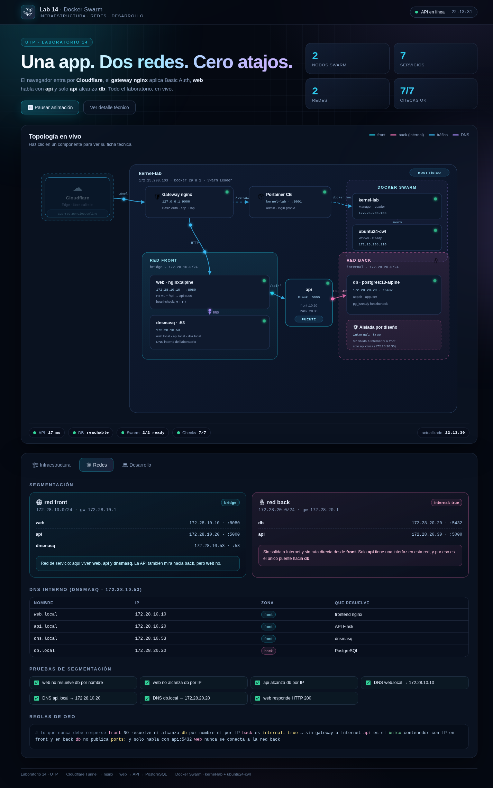
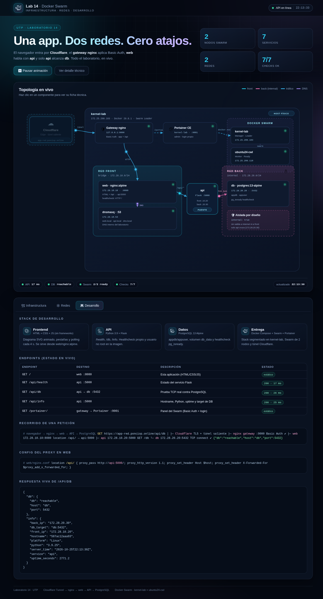
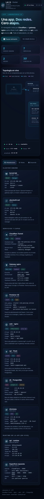
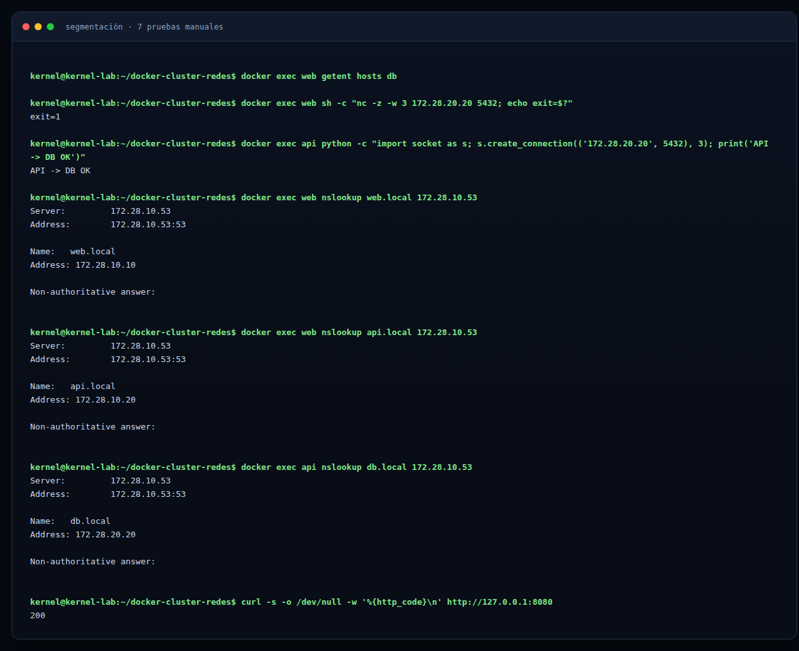
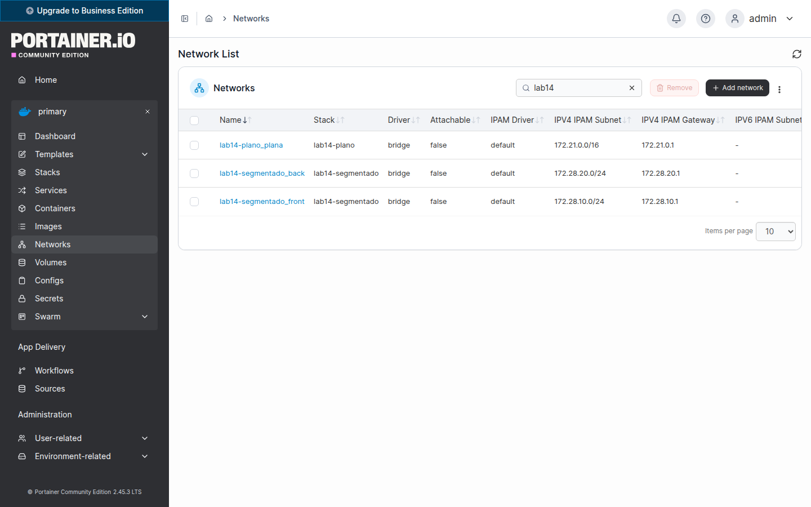
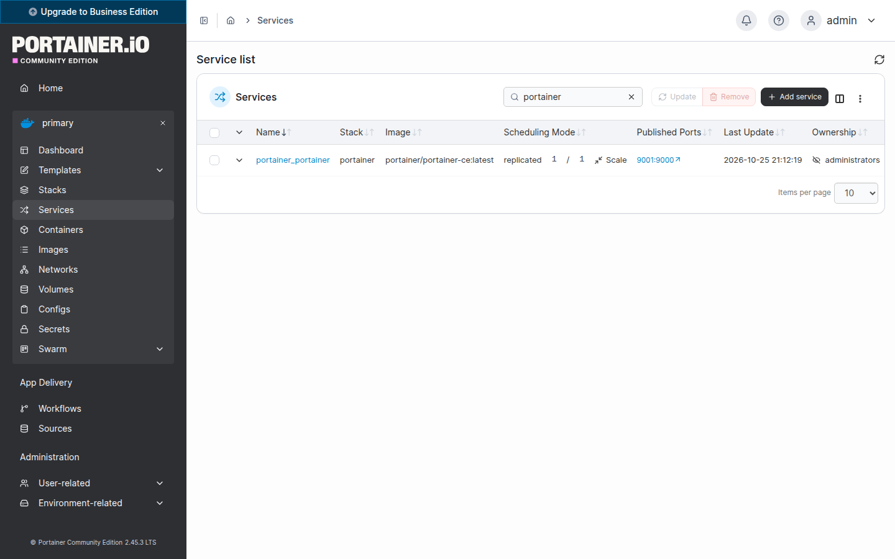
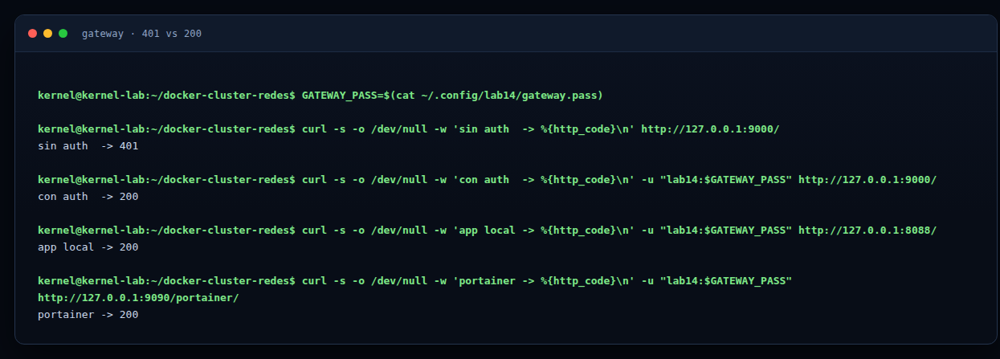

# Guía del clúster — Laboratorio 14

Guía única para replicar el **clúster Docker Swarm con Portainer y la red
segmentada** del Laboratorio 14 (UTP, Redes de Computadoras) en tus propias
máquinas. Está dividida en tres partes, en el mismo orden en que se arma el
laboratorio:

| Parte | Qué haces | Tiempo aproximado |
|---|---|---|
| [Parte 1 — Maestro y Portainer](#parte-1--maestro-y-portainer) | Inicias el Swarm y despliegas Portainer | 20–30 min |
| [Parte 2 — Worker](#parte-2--worker) | Unes la segunda máquina al clúster | 10–15 min |
| [Parte 3 — Segmentación, app y gateway](#parte-3--segmentación-app-y-gateway) | Levantas la app, verificas el aislamiento y publicas con Basic Auth | 30–45 min |

> **Cloudflare Tunnel no es requisito.** El laboratorio se completa en tu red
> local. El túnel solo se menciona como extensión opcional al final de la
> Parte 3.

## Qué vas a construir



Dos máquinas Linux con Docker Swarm: una hace de **maestro** (manager) y la otra
de **worker**. Sobre el maestro corren Portainer y la app de tres capas
`web → api → db`, con la base de datos aislada en la red `back`.

## Antes de empezar

### Lo que necesitas

- Dos máquinas Linux (Ubuntu 22.04/24.04 o Debian) con **2 GB de RAM** y
  **10 GB de disco** como mínimo.
- Las dos máquinas en la **misma red local** y con IP fija o reservada.
- Acceso `sudo` para instalar Docker y abrir puertos del firewall.
- **No necesitas** dominio ni Cloudflare.

### Valores de ejemplo

En esta guía se usan estos valores. Reemplázalos por los de tu red:

| Dato | Ejemplo |
|---|---|
| IP del maestro | `192.168.1.100` |
| IP del worker | `192.168.1.101` |
| Usuario de las máquinas | `ubuntu` |
| Repositorio en el maestro | `~/docker-cluster-redes` |

> Ejecuta cada comando en la máquina que se indica. Los comandos que dicen
> “en el maestro” no funcionan en el worker.

### Instala Docker en las dos máquinas

En **cada máquina**:

```bash
sudo apt update
sudo apt install -y docker.io docker-compose-v2
sudo systemctl enable --now docker
sudo usermod -aG docker "$USER"
```

Cierra sesión y vuelve a entrar (o ejecuta `newgrp docker`) para usar Docker sin
`sudo`. Comprueba:

```bash
docker --version
docker compose version
```

### Descarga el repositorio en el maestro

```bash
git clone https://github.com/isaca0315/docker-cluster-redes.git ~/docker-cluster-redes
cd ~/docker-cluster-redes
```

En el **worker** no necesitas el repositorio para unirte al clúster: basta con
Docker.

### Comprueba que los puertos estén libres

En el **maestro**:

```bash
ss -ltn | grep -E ':(8080|8081|8088|9000|9001|9090) ' || echo "puertos del laboratorio libres"
```

Si aparece alguno ocupado, detén el servicio que lo esté usando antes de
continuar.

---

## Parte 1 — Maestro y Portainer

### 1.1 Inicia el Swarm

En el **maestro**:

```bash
docker swarm init --advertise-addr 192.168.1.100
```

Docker imprime un comando `docker swarm join --token ...` para los workers.
**Cópialo**, lo usarás en la Parte 2. Si lo pierdes, puedes recuperarlo cuando
quieras:

```bash
docker swarm join-token worker
```

Comprueba que el maestro quedó como líder:

```bash
docker node ls
```

Debe aparecer una sola fila, con `Leader` en la columna `MANAGER STATUS`.

### 1.2 Despliega Portainer

En el **maestro**, dentro del repositorio:

```bash
cd ~/docker-cluster-redes
docker stack deploy -c docker-compose-portainer.yml portainer
```

Espera unos segundos y comprueba:

```bash
docker stack services portainer
docker service ps portainer_portainer
```

`REPLICAS` debe mostrar `1/1`.

### 1.3 Abre el firewall del maestro

Si usas `ufw`, permite el tráfico del clúster y la interfaz de Portainer:

```bash
sudo ufw allow 2377/tcp    # gestión del Swarm
sudo ufw allow 4789/udp    # red overlay
sudo ufw allow 7946/tcp    # gossip entre nodos
sudo ufw allow 7946/udp
sudo ufw allow 9001/tcp    # Portainer
sudo ufw status
```

No abras `8080`, `8081` ni `9000`: esos puertos escuchan solo en loopback.

### 1.4 Crea el usuario administrador de Portainer

Abre en tu navegador:

```text
http://192.168.1.100:9001
```

Crea el usuario administrador y selecciona el entorno **Local**. Hazlo dentro de
los primeros 5 minutos; si Portainer se reinicia antes, vuelve a intentarlo.



**Comprobación de la Parte 1**

```bash
docker node ls
docker stack services portainer
```

Esperado: un nodo `Ready` con `Leader` y Portainer en `1/1`.

---

## Parte 2 — Worker

### 2.1 Prepara el worker

En el **worker**, instala Docker igual que en el maestro y comprueba que las dos
máquinas se ven:

```bash
ping -c 3 192.168.1.100
docker --version
```

### 2.2 Une el worker al Swarm

En el **maestro**, obtén el comando de unión:

```bash
docker swarm join-token worker
```

Copia el comando completo y ejecútalo en el **worker**. Se ve así:

```bash
docker swarm join --token SWMTKN-1-xxxxxxxxx 192.168.1.100:2377
```

La salida correcta termina con:

```text
This node joined a swarm as a worker.
```

### 2.3 Verifica el clúster

En el **maestro**:

```bash
docker node ls
```

Debes ver **dos nodos** en `Ready`, con el maestro como `Leader`:

```text
ID       HOSTNAME    STATUS    AVAILABILITY   MANAGER STATUS
abc123 * maestro     Ready     Active         Leader
def456   worker      Ready     Active
```

### 2.4 Abre el firewall del worker

En el **worker**, si usas `ufw`:

```bash
sudo ufw allow 2377/tcp
sudo ufw allow 4789/udp
sudo ufw allow 7946/tcp
sudo ufw allow 7946/udp
sudo ufw status
```

### 2.5 Confirma el worker en Portainer

En Portainer ve a **Nodes**. Deben aparecer las dos máquinas. Si no aparece el
worker, revisa que `docker node ls` lo muestre como `Ready` y que el puerto
`2377` esté abierto en el maestro.

**Comprobación de la Parte 2**

```bash
docker node ls
```

Esperado: 2 nodos `Ready`, uno `Leader`.

---

## Parte 3 — Segmentación, app y gateway

### 3.1 Primero, la red plana (el problema)

Este stack demuestra lo que ocurre cuando todos los servicios comparten la misma
red: la web alcanza la base de datos directamente.

En el **maestro**, dentro del repositorio:

```bash
cd ~/docker-cluster-redes
docker compose -f docker-compose-network-planos.yml up -d
docker compose -f docker-compose-network-planos.yml ps
```

Comprueba el problema:

```bash
docker exec web-planos sh -c "nc -z -w 3 db 5432 && echo 'web alcanza db (inseguro)'"
curl -s -o /dev/null -w 'web plana -> %{http_code}\n' http://127.0.0.1:8081
```

Esperado: `web alcanza db (inseguro)` y `200`. La web de la red plana está en
`http://127.0.0.1:8081`.

> La red plana y la segmentada pueden convivir porque cada archivo declara un
> proyecto distinto (`lab14-plano` y `lab14-segmentado`). No levantes dos veces
> el mismo archivo con nombres de proyecto diferentes.

### 3.2 Levanta la red segmentada

```bash
docker compose -f docker-compose-network.yml up -d
docker compose -f docker-compose-network.yml ps
```

Espera a que `web`, `api` y `db` aparezcan como `healthy` (puede tardar unos
segundos). La app queda en:

- `http://127.0.0.1:8080` — acceso directo, sin autenticación.
- `http://127.0.0.1:8088` — a través del gateway con Basic Auth (Parte 3.4).


La app tiene tres pestañas. En **Redes** se ven las subredes, las IP fijas y las
pruebas de segmentación; en **Desarrollo**, los endpoints y el estado en vivo de
la API:





También se adapta a la pantalla de un celular:



Cómo quedó armado el stack:

| Servicio | Redes | IP | Rol |
|---|---|---|---|
| `dnsmasq` | `front` | `172.28.10.53` | DNS interno de `.local` |
| `web` | `front` | `172.28.10.10` | nginx; publica `8080` solo en loopback |
| `api` | `front` + `back` | `.10.20` y `.20.30` | único puente hacia la DB |
| `db` | `back` | `172.28.20.20` | PostgreSQL; sin puertos publicados |

La clave está en `docker-compose-network.yml`:

```yaml
networks:
  back:
    driver: bridge
    internal: true    # sin salida al exterior y sin ruta desde front
```

### 3.3 Verifica la segmentación (7 pruebas)

Ejecuta cada comando y compara con el resultado esperado.

```bash
# 1) web NO resuelve db por nombre -> sin salida
docker exec web getent hosts db

# 2) web NO alcanza db por IP -> exit=1
docker exec web sh -c "nc -z -w 3 172.28.20.20 5432; echo exit=\$?"

# 3) api SÍ alcanza db -> API -> DB OK
docker exec api python -c "import socket as s; s.create_connection(('172.28.20.20', 5432), 3); print('API -> DB OK')"

# 4) DNS web.local -> 172.28.10.10
docker exec web nslookup web.local 172.28.10.53

# 5) DNS api.local -> 172.28.10.20
docker exec web nslookup api.local 172.28.10.53

# 6) DNS db.local -> 172.28.20.20
docker exec api nslookup db.local 172.28.10.53

# 7) web responde HTTP 200
curl -s -o /dev/null -w '%{http_code}\n' http://127.0.0.1:8080
```

| # | Resultado esperado |
|---|---|
| 1 | sin salida |
| 2 | `exit=1` |
| 3 | `API -> DB OK` |
| 4 | `172.28.10.10` |
| 5 | `172.28.10.20` |
| 6 | `172.28.20.20` |
| 7 | `200` |



En Portainer, entra a **Networks** y confirma que existen
`lab14-segmentado_front` y `lab14-segmentado_back`; la red `back` debe aparecer
como interna:



En **Services** deben aparecer los contenedores del stack en ejecución:



Los nombres `web.local`, `api.local` y `db.local` deben coincidir con las IP
fijas del compose y con `dnsmasq.conf`.

### 3.4 Gateway con Basic Auth

El gateway está en `infra/gateway/`. Escucha solo en loopback y protege la app y
Portainer con usuario y contraseña.

```bash
cd ~/docker-cluster-redes/infra/gateway

# Pide la contraseña sin mostrarla
read -r -s -p 'Clave para el usuario lab14: ' GATEWAY_PASS; echo

# Genera el hash para nginx
docker run --rm httpd:alpine htpasswd -nbB lab14 "$GATEWAY_PASS" > .htpasswd

# Guarda la contraseña solo para tu usuario
mkdir -p ~/.config/lab14
printf '%s' "$GATEWAY_PASS" > ~/.config/lab14/gateway.pass
chmod 600 .htpasswd ~/.config/lab14/gateway.pass

# Levanta el gateway
docker compose up -d
cd ~/docker-cluster-redes
```

Comprueba el acceso local:

```bash
GATEWAY_PASS=$(cat ~/.config/lab14/gateway.pass)

curl -s -o /dev/null -w 'sin auth  -> %{http_code}\n' http://127.0.0.1:9000/
curl -s -o /dev/null -w 'con auth  -> %{http_code}\n' \
  -u "lab14:$GATEWAY_PASS" http://127.0.0.1:9000/
curl -s -o /dev/null -w 'app local -> %{http_code}\n' \
  -u "lab14:$GATEWAY_PASS" http://127.0.0.1:8088/
curl -s -o /dev/null -w 'portainer -> %{http_code}\n' \
  -u "lab14:$GATEWAY_PASS" http://127.0.0.1:9090/portainer/
```

Esperado:

```text
sin auth  -> 401
con auth  -> 200
app local -> 200
portainer -> 200
```

Abre `http://127.0.0.1:8088/` y `http://127.0.0.1:9090/portainer/` e inicia
sesión con el usuario `lab14` y la contraseña que elegiste.



> `.htpasswd` está en `.gitignore`. Nunca lo subas al repositorio ni escribas la
> contraseña en la documentación.

### 3.5 Acceso desde otra computadora (opcional)

El gateway solo escucha en `127.0.0.1`. Si tu navegador está en otra máquina,
abre un túnel SSH desde tu computadora:

```bash
ssh -L 8088:127.0.0.1:8088 \
    -L 9090:127.0.0.1:9090 \
    usuario@192.168.1.100
```

Luego abre `http://localhost:8088/` y `http://localhost:9090/portainer/`.

Portainer también está disponible en la red local en
`http://192.168.1.100:9001/`, solo con su propio login (sin el Basic Auth del
gateway).

### 3.6 Cloudflare Tunnel (opcional, no requerido)

**No lo necesitas para completar el laboratorio.** Si tienes un dominio en
Cloudflare y quieres publicar la app en Internet, crea un túnel y agrega dos
*public hostnames*:

| Hostname | Servicio local |
|---|---|
| `app-red.<tu-dominio>` | `http://localhost:9000` |
| `cluster-red.<tu-dominio>` | `http://localhost:9001` |

Instala `cloudflared` en el maestro y ejecuta el túnel. No abras puertos en el
router: el túnel es saliente. La app pública queda protegida por el Basic Auth
del gateway y Portainer por su propio login.

**Comprobación de la Parte 3**

Repite las 7 pruebas de la sección 3.3 y comprueba el gateway:

```bash
curl -s -o /dev/null -w 'app local -> %{http_code}\n' \
  -u "lab14:$(cat ~/.config/lab14/gateway.pass)" http://127.0.0.1:8088/
```

Esperado: las 7 pruebas coinciden con la tabla y `app local -> 200`.

---

## Lista de control final

Marca cada punto antes de entregar:

| # | Comprobación | Resultado esperado |
|---|---|---|
| 1 | `docker node ls` | 2 nodos `Ready`, maestro `Leader` |
| 2 | `docker stack services portainer` | `portainer_portainer` en `1/1` |
| 3 | Login de Portainer en `http://192.168.1.100:9001` | entra con el usuario admin |
| 4 | `docker compose -f docker-compose-network.yml ps` | `web`, `api` y `db` en `healthy` |
| 5 | Las 7 pruebas de la sección 3.3 | todas coinciden |
| 6 | `docker exec web getent hosts db` | sin salida (no resuelve) |
| 7 | `docker exec web sh -c "nc -z -w 3 172.28.20.20 5432"` | falla (sin ruta) |
| 8 | `docker exec api python -c "import socket as s; s.create_connection(('172.28.20.20',5432),3)"` | conecta |
| 9 | `docker exec web nslookup web.local 172.28.10.53` | `172.28.10.10` |
| 10 | `docker network inspect lab14-segmentado_back` | `"Internal": true` |
| 11 | `docker ps` | `db` sin puerto publicado |
| 12 | `curl` al gateway sin credenciales | `401` |
| 13 | `curl` al gateway con credenciales | `200` |
| 14 | `http://127.0.0.1:8088/` | app completa |
| 15 | `git status` | sin `.htpasswd` ni contraseñas |

## Si algo falla

| Síntoma | Causa probable | Solución |
|---|---|---|
| El worker no se une | puerto `2377` cerrado o IP incorrecta | `ping` al maestro, abre `2377/tcp`, revisa el token |
| `docker node ls` no muestra el worker | el `join` no terminó | en el worker: `docker swarm leave --force` y repite el join |
| Portainer no abre | puerto `9001` ocupado o el servicio no arrancó | `docker stack services portainer`, `ss -ltn \| grep 9001` |
| `port is already allocated` | otro stack usa `8080`/`8081` | detén el stack anterior con `docker compose ... down` |
| `web` en `unhealthy` | healthcheck mal configurado | debe usar `127.0.0.1`, no `localhost` |
| `nslookup` da timeout | `interface=0.0.0.0` en `dnsmasq.conf` | elimina esa línea y recrea `dnsmasq` |
| Levantar un stack borra el otro | mismo proyecto compose | cada archivo debe tener su propio `name:` |
| `docker stack deploy` rechaza IPs o `build:` | limitación de Swarm | usa `docker compose` para este stack |
| `web` SÍ alcanza la DB | falta `internal: true` o la DB publica `ports:` | corrige el compose y vuelve a levantar |
| El gateway da `401` con la clave correcta | `.htpasswd` viejo o contenedor sin recrear | repite el paso del `.htpasswd` y `docker compose up -d --force-recreate` |
| El gateway da `502` | `web` o `api` caídos | `docker ps`, `docker logs web`, `docker logs api` |
| Portainer carga lento por el túnel | bundles grandes | usa el acceso local `9090`; el túnel es opcional |

## Limpieza

Cuando termines, puedes apagar todo. **Cuidado:** `down -v` borra los datos de
la base de datos y de Portainer.

```bash
cd ~/docker-cluster-redes

# Stack segmentado (sin -v conserva los datos)
docker compose -f docker-compose-network.yml down

# Red plana de demostración
docker compose -f docker-compose-network-planos.yml down

# Gateway
cd infra/gateway
docker compose down
cd ~/docker-cluster-redes

# Portainer
docker stack rm portainer

# Salir del Swarm (primero el worker, después el maestro)
# docker swarm leave --force
```

## Puertos del laboratorio

| Puerto | Interfaz | Uso |
|---|---|---|
| `2377` | LAN (TCP) | Gestión de Docker Swarm |
| `4789` | LAN (UDP) | Red overlay |
| `7946` | LAN (TCP/UDP) | Gossip entre nodos |
| `9001` | LAN | Portainer (`9001 → 9000`) |
| `9000` | `127.0.0.1` | Gateway nginx |
| `8088` | `127.0.0.1` | App a través del gateway |
| `9090` | `127.0.0.1` | Portainer a través del gateway |
| `8080` | `127.0.0.1` | App directa, sin auth |
| `8081` | `127.0.0.1` | Web de la red plana (demo) |

No expongas `2377`, `7946`, `4789` ni el socket de Docker a Internet.
